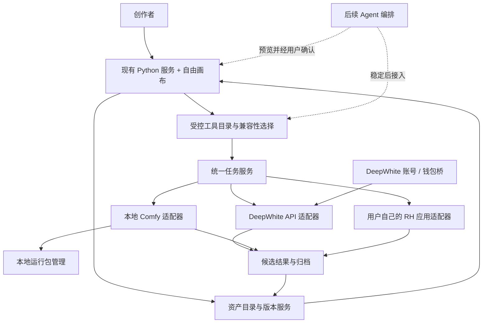
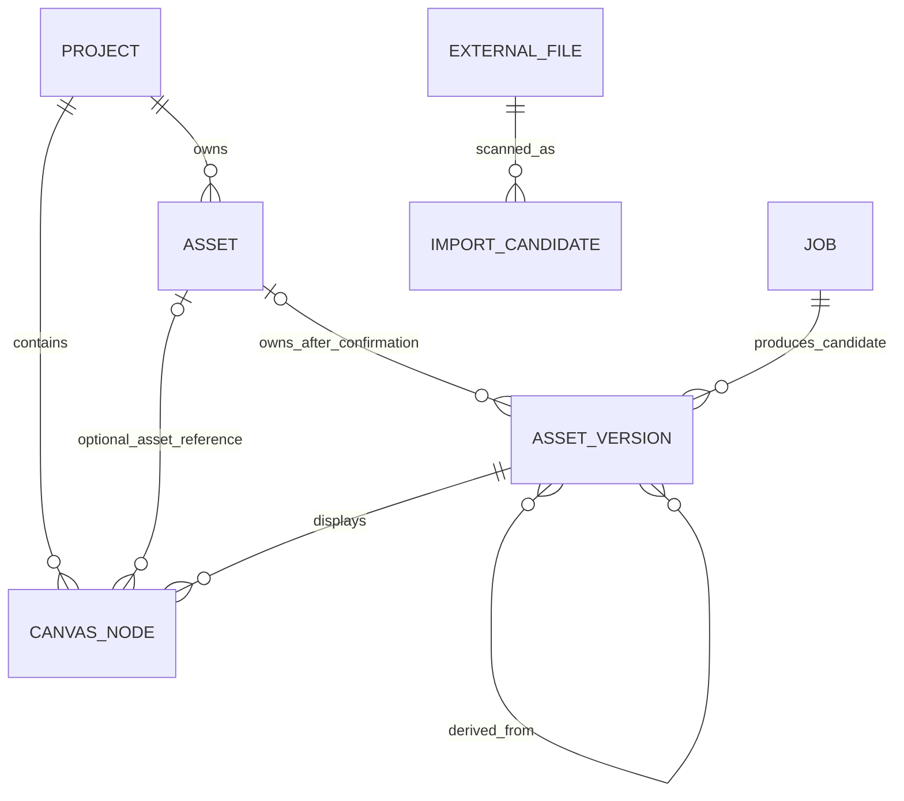

# DeepWhite Studio 产品架构与阶段路线 v0.3

日期：2026-09-24
状态：设计稿，供产品评审和交互预览使用；本文不代表下述规划功能已开发、接通或验收。
本轮范围：完成产品架构、数据边界、模块契约、阶段路线和交互原型；不开发正式功能、不连接付费服务、不下载安装运行包。

## 1. 设计依据与产品边界

DeepWhite Studio 继续以现有 Python 服务和原版自由画布为产品基础，在原有入口上逐步加入可验证的专业工具。架构采用渐进式模块化单体：一个本机 Python 服务负责画布 API、任务、资产索引和适配器；先划清模块接口，再按用户价值逐步拆开实现。当前没有引入微服务、第二套画布或独立云端项目服务的理由。

需求和现状按三类记录：

| 标记 | 含义 |
| --- | --- |
| 已有 | 在当前代码或既有验收记录中能找到实现证据；不自动等于已完整验收 |
| 设计 | 本文规定的目标行为，尚未因写入文档而实现 |
| 待验证 | 需要产品选择、外部服务能力、工作流/模型样例或运行环境验证 |

当前代码依据包括 `main.py`、`studio_server.py`、`studio_generation.py`、`studio_comfy.py`、`studio_comfy_engine.py`、`studio_account.py`、`studio_pricing.py`、`studio_skills.py` 和画布的 `static/js/canvas.js`。具体已知边界见 `docs/DeepWhite-Studio需求大纲.md`、`docs/account-skills-pricing.md` 与 `docs/design-v1/设计包.md`。

Fisher/AIFISHER 的公开实现和其他外部工具（包括被称为“土豆”的参考项目）只提供可研究的设计思路。引用它们不表示 DeepWhite 已具备相同能力；产品能力以本仓库可见代码和 DeepWhite 自己的验收记录为准。本轮不把外部特性写成现成功能。

## 2. 产品模块图

`Tools` 描述用户能做什么，`Adapters` 描述任务实际交给谁执行，`Assets` 保存内容身份和版本，`CanvasNode` 保存内容在画布中的呈现与空间位置。模型或工作流变化不应改写资产身份；移动画布节点不应移动或覆盖素材文件。

## 3. 模块职责与接口约定

| 模块 | 职责 | 主要输入 / 输出 | 现状与阶段 |
| --- | --- | --- | --- |
| 画布与项目 | 保留原版自由画布、项目保存、连线、撤销和节点操作；展示工具面板与资产引用 | `project_id`、`node_id`、`asset_id`、`version_id` | 已有基础画布；各新增功能按阶段接入，不重写画布引擎 |
| 工具目录 | 发布经过检查的工具、版本、输入输出角色、参数与可用执行方式 | `tool_id@version`、兼容性选项、校验结果 | 分散在现有能力表和媒体工具中；0.4起逐步整理 |
| 兼容性目录 | 展示“工具方案 → 支持的模型/执行来源”；过滤不匹配输入与参数 | 工具、方案、模型/包能力快照 | 设计；不暴露任意 Comfy 节点连线或原始图字段 |
| 资产服务 | 管理稳定资产、只增不覆盖的版本、候选结果、用户确认、托管文件 | 资产元数据、版本、候选、归档动作 | 现有素材库和任务输出可复用；稳定 ID/版本关系待 0.4 |
| 任务服务 | 持久化提交前请求，管理状态、恢复查询、取消边界、结果候选 | `job_id`、幂等键、工具/方案版本、参数和素材快照 | 现有 API 与本地任务已有部分能力；先保留现有防重复提交规则 |
| DeepWhite API 适配 | API 密钥配置、能力同步、估价证据、生成和账单结果 | 不向前端返回密钥；返回任务/价格状态 | 已有；按现有 DeepWhite API 契约维护 |
| Comfy 适配 | 管理受控本地实例、提交预置工作流、回传结果 | `recipe_id@version`、托管素材引用、参数映射 | 已有单一 Qwen 工作流和本地引擎管理；通用受控目录待扩展 |
| RH 适配 | 使用用户自己的 RH 账号/应用及其授权工作流 | RH 应用/工作流引用、用户凭据、参数映射 | 现有仓库有 RH 接口基础；用户应用授权、版本和计费待核实 |
| 账号桥 | 处理 DeepWhite 站点登录、账号信息、钱包与登录状态 | HttpOnly 本机会话；余额及站点返回信息 | 已有密码+两步验证和余额读取；微信扫码登录待站点支持和验收 |
| 本地运行包管理 | 选择/检查运行包，启动 DeepWhite 自己创建的进程，保存版本和状态 | 包版本、目录、服务状态；不返回任意执行命令 | 当前只支持选目录并启动 Comfy 的基础能力；纯净整合包未交付 |
| Agent 编排 | 根据自然语言提取意图，调用白名单工具并生成待确认计划 | 工具目录、项目上下文、计划预览 | 后续 0.6；必须晚于工具契约和任务行为稳定 |
| 桌面与更新 | 以桌面壳承载现有本地服务，升级时保留用户数据并可恢复 | 安装版本、更新包签名/校验结果、回滚状态 | 待设计评审和依赖核实；当前启动入口仍是本机服务/浏览器 |

所有模块之间传递稳定 ID 和版本号，不传私密凭据或操作系统绝对路径作为业务身份。接口返回结构统一包含 `ok`、`data` 或结构化 `error`；错误包含可显示的 `code`、简短 `message`、是否可安全重试及任务/候选 ID（若存在），不把原始密钥、Cookie、完整本地路径或服务堆栈发给浏览器。

工具执行请求最低包含：`project_id`、`tool_id`、`tool_version`、`recipe_id`、`recipe_version`、输入资产版本列表、经允许的参数、`idempotency_key`。服务端再次检查工具和方案版本、输入角色、文件状态、范围和参数。提交响应先给 `job_id` 和初始状态，之后通过现有轮询/消息机制推送状态。调用者只能请求“预估、提交、查询、请求取消”；不能提交任意 Comfy graph、远端 URL 或任意进程命令。

## 4. 资产、版本、节点与候选结果

### 数据关系

- **Project** 保存画布和用户选择的受管项目目录位置；路径是可迁移的存储配置，不作为项目或素材身份。
- **Asset** 是逻辑内容身份，有稳定随机 ID、项目归属、媒体种类、创建时间和可读名称。角色标签可改，不作为 ID。
- **AssetVersion** 是不可变内容快照，有生成时即分配的稳定 `version_id`，记录文件内容哈希、媒体元数据、父版本/输入版本、来源任务、工具/方案版本、参数摘要及状态。状态从 `candidate` 转为 `archived`，确认时可绑定 `asset_id`；状态和归属可以变，内容、哈希和 `version_id` 不变。重做编辑产生新版本；除非用户明确删除或清理策略执行，否则不覆盖旧文件。
- **CanvasNode** 只负责画布表现，包括位置、尺寸、选中状态、用户草稿和指向 `asset_id` / `version_id` 的引用。一个资产可以出现在多个节点；节点删除不删除资产或版本。
- **Job** 是执行记录，冻结提交时的提示词、参数、输入版本和工具/方案版本，确保以后能解释结果来自何处。
- **候选结果**是 `AssetVersion.status=candidate` 的版本状态，不是没有稳定身份的临时文件。任务完成后，先将结果持久保存并为版本分配稳定 ID，再在任务原画布节点内立即展示；节点引用这个候选版本。写入成功前任务不得报告完成。画布出现结果不等于资产归档确认。

### 归档交互

任务完成后，候选版本立即出现在原画布节点并自动持久保存；候选列表可作为跨节点的管理视图，显示来源工具、模型/运行方式、时间和可用费用证据。用户可把它留作候选、确认成为新资产，或确认归入已有资产的新版本。确认只改变候选的生命周期状态和资产归属，不重写文件、内容哈希或版本 ID；同一画布节点继续引用同一个版本，确认前后链接不变。“加入画布”或从候选列表恢复引用只改变节点展示，不构成正式归档确认。候选可预览、删除或稍后处理；清理候选不得误删已归档版本，若节点仍引用已清理候选则保留可识别的已删除占位状态。

结果接入由任务服务协调：分配稳定 `version_id`，先将输出写入候选暂存区并校验，持久保存版本元数据，再把原任务节点的结果引用和任务完成状态一并提交，最后通知画布刷新。中途崩溃时按候选清单恢复；不得出现任务显示成功但原节点没有可恢复结果的状态。

### 受管项目目录与外部导入：首期单向

用户为项目选择 DeepWhite 负责整理的受管项目目录。正式归档的资产版本按项目、资产身份和版本自动写入该目录；提供“打开所在文件夹”入口。候选在确认前保存在 DeepWhite 管理的候选区，并已登记稳定版本 ID；确认后再落盘到项目目录。

软件对受管项目目录只做单向写出和受控整理。用户可从其他外部目录发起显式导入：扫描先生成候选，用户预览并确认后复制进 DeepWhite 管理范围，记录哈希、来源相对路径与导入时间；外部原文件不被改写、重命名、移动或删除。首期不监控并反向同步用户在文件管理器中对受管目录所做的任意改名、移动或删除；双向同步后置。

文件落盘需使用事务状态：先写入同卷唯一临时文件并校验大小/哈希，再原子改名到最终唯一文件名，随后提交索引。相同人类可读名称的不同版本追加版本号或短 ID，禁止覆盖。若写入/索引提交失败，保留候选身份与可恢复状态，明确显示失败并允许重试，不把未落盘版本标成已归档。崩溃恢复和“修复索引”按已提交清单扫描核对文件：发现完整但未登记文件时可重建索引候选，发现索引指向的文件缺失时标记缺失并允许重新定位/恢复，不自动删除内容或改变版本身份。

## 5. 工具方案与执行来源

普通用户先选创作工具（例如“图片高清”或“拆解重绘”），再看到当前可用方案和兼容模型。方案来源可以是 DeepWhite API、DeepWhite 预置的 Comfy 工作流或用户自己的 RH 应用。具体能否选择取决于模型能力、工具输入角色、尺寸/格式、参数契约和本地包/远端授权状态；没有经过验证的组合应显示不可用原因，而非让用户提交后才失败。

Comfy 工作流由产品制作方预置并验证。普通界面只暴露允许的创作参数和输入素材；节点 ID、工作流 JSON、字段映射和模型文件名都留在版本化方案内部。用户可选兼容模型，但只从方案声明且已检查的清单中选择。不提供画布连线式工作流编辑器，不让用户任意改图或导入未审查图作为基础入口。自定义工作流管理若要开放，必须另行定义权限、兼容和恢复设计。

每个 `Tool` 记录 `tool_id`、显示名、版本、输入/输出角色、参数 Schema、验证规则、支持的执行适配器和状态；每个 `Recipe` 记录 `recipe_id`、版本、`tool_id`、执行适配器、兼容模型/包范围、参数映射、工作流摘要、输出映射、依赖、取消行为和验证状态。只有 `verified` 方案出现在可运行列表；未实测项只能以研究/预览状态呈现。

RH 入口指向用户自己有权使用的 RH 应用/工作流。DeepWhite 保存必要的引用与映射，并用现有凭据边界调用；不把 Fisher 的 RH 行为、外部项目的工作流或演示数据冒充成用户应用。应用所有权、授权方式、费用结算、工作流版本固定方式和跨账号可见性是接入前置条件。

## 6. 账号、钱包、密钥与隐私

DeepWhite API 账号和模型调用 API Key 是不同凭据：账号用于身份/钱包页面，模型任务仍按已配置 Provider 的 API Key 请求。账户余额不可视为 API Key 额度，也不可在预估时互换。登录 Cookie 只保存在后端进程的短期会话，浏览器只持有 HttpOnly、Secure（适用时）、SameSite 会话标记；密码和一次性码不持久化。注销、过期和后台重启清除会话。

界面整合为一个“DeepWhite 账号与钱包”入口：登录态、余额、刷新和去站点充值/账户管理放在同一处；设置里的模型服务密钥仍明确独立。账号接入保留服务端抽象：`begin_login`、`complete_login`、`get_account`、`get_wallet`、`logout`。现有路径使用用户名/密码和两步验证码；微信扫码是设计目标，不代表 api.deepwhiteai.com 当前提供扫码授权接口。只有站点提供可支持且安全的扫码/轮询/回调契约后，才实现另一种登录方式。不得自行模拟扫码成功、从浏览器窃取 Cookie 或保存账号密码。

每个费用相关字段必须标明 `estimated`、`actual`、`unknown` 或 `local_runtime` 与证据来源/版本。估价沿用本地 DeepWhite `/api/pricing` 数据和现有匹配约束；未知价格显示待查询。本地运行耗时/资源估计不伪装为云端免费账单；RH 的实际收费以用户 RH 账户记录为准。

## 7. Agent 和 Skill 的启用门槛

正式 Agent 排在稳定工具之后。0.6 以前不显示可写的正式 Agent 入口，也不允许真实 Agent 自动新增画布节点或提交任务。本轮 0.3 交互预览可以提供明确标注“演示”的本地计划流程：选择演示内容后展示计划，再由用户确认把示例节点写入预览画布；它只操作演示内存状态，不调用模型、工具、API、RH、Comfy 或正式项目数据。这个演示用于评审操作顺序，不代表产品 Agent 已实现。

0.6 的 Agent 只通过工具目录调用带版本的白名单工具，并复用任务服务，不建立另一条生成协议。首批流程先读取项目内容并生成结构化计划，列出将创建/更新的节点、每步输入资产、方案、参数、费用证据和执行来源；用户分别确认“写入画布”和“提交任务”。生成额度、云上传或调用 RH 的步骤必须单独可见，不能因一句“帮我做完”就静默提交。

Skill 入口在本路线的初期版本暂时隐藏，避免在 Agent 编排和权限行为未定时把导入技能当成自动化能力宣传。现有无脚本文本 Skill 能力应保持兼容；不在 0.4/0.5 删除或执行导入内容。恢复入口时要明确权限、内容来源、引用和上下文可见性；始终禁止把 Skill 内代码当作可执行脚本。

Fisher 的工具调用架构只作为参考：DeepWhite 必须先有自己的稳定工具 ID、Schema、错误和任务状态；完成 Agent 计划/确认/复用工具的验收后，才能说 Agent 可用。外部项目里存在的自动建节点、批量调度或 RH 工具都不构成本产品实现证据。

## 8. 本地服务、桌面打包与更新

### 桌面产品边界

正式桌面包延续“桌面外壳 + 本机 Python 服务 + 静态前端 + 独立用户数据目录”的分层结构，继续使用现有画布服务和 API 边界。桌面壳负责启动/停止、健康检查、打开工作区和升级协调；生成与资产业务继续由本地 Python 服务处理。安装目录与可写数据目录分离，更新程序不能覆盖项目、任务记录、托管素材或凭据配置。

目标形态的本地服务默认只监听回环地址。鉴权令牌不得泄露给外部来源或普通网页内容；可信桌面窗口若需访问受保护接口，应通过受限桌面桥按需取得能力，不把长期令牌注入 DOM、URL 或可被任意网站读取的存储。当前无令牌的浏览器运行模式没有实现这层本机鉴权，不应描述为已受令牌保护；这是 0.7 发布基础的设计要求。浏览器版可继续作为当前本地入口。桌面包是否自带 Python、选用何种外壳、安装器格式、代码签名与更新托管当前均为待验证事项，不能由本架构稿视为已选型或已实现。

升级需检查包签名/完整性、版本兼容、磁盘空间、当前任务；先暂存新版本与用户数据备份，再切换程序文件。新版本启动健康确认成功才提交升级；超时或服务不可用时恢复旧程序。更新包不包含用户密钥和个人数据。允许用户推迟升级；运行中的付费任务不被安装退出静默中断。安装、迁移、更新、卸载必须分别说明何者保留与何者删除。

### 运行包和服务器依赖

- Comfy 整合包是可选的本地执行依赖，不是 DeepWhite 桌面外壳。API-only 用户无需下载；已有兼容目录可选择复用。
- DeepWhite 自己管理的本地 Comfy 实例有明确包版本、监听端口、进程所有权和日志。可以复用用户手动启动且兼容的本机实例；退出时只停止由 DeepWhite 启动且没有未处理任务的实例。
- 本地用户文件夹和模型目录不因 DeepWhite 更新而清理；模型/自定义节点不自动升级。纯净可分发运行包由用户后续准备，个人开发目录不作为下载包。
- DeepWhite API 账号/钱包、模型 API、RH 和更新托管分别是外部服务依赖；它们失联时，界面说明受影响的功能。本地已保存画布与素材仍可访问。
- 本地 Python 服务的运行时、系统 DLL、数据库、GPU 驱动与模型依赖需按目标 Windows 包实测并记录版本；不能把开发机安装状态当作完整分发方案。

## 9. 阶段路线与验收条件

所有阶段都按“设计通过 → 交互预览 → 实现 → 逐项验收”推进。本轮只完成 0.3 的架构文档与不调用真实服务的交互预览。阶段名称不是已完成状态；每个功能仍须记录设计、模拟验收、真实验收的差别。

| 版本 | 目标和范围 | 验收条件 | 关键外部依赖 |
| --- | --- | --- | --- |
| **0.3 设计版（本轮）** | 定义总体模块、资产身份、任务与账号边界、Comfy/RH 方案、Agent 门槛、桌面与更新路线；制作本地交互预览 | 用户能从预览理解普通画布入口、工具选择、模型兼容性、候选归档、账号/钱包与后续 Agent 的位置；允许走明确标“演示”的计划→确认→示例节点流程；演示只改预览状态，不调用 API/RH/Comfy、不写正式项目数据、演示余额/示意素材明确标注，绝不冒充真实余额或生成效果；架构稿明确哪些是现有、设计、待验证 | 无在线依赖；只需本地静态预览 |
| **0.4 资产基础** | 为旧画布节点增加可迁移的 `asset_id` / `version_id` 引用；任务结果在原节点立即可见并持久保存为候选版本；确认归档只改变状态/归属；加入受管项目目录自动整理、打开所在文件夹和外部文件显式导入 | 旧项目可无损打开；节点移动/复制不改变文件身份；节点删除不误删资产；输出落盘后原节点引用稳定候选 ID；确认前后版本 ID 和内容不变；同名不覆盖、文件写入原子化；失败可恢复、索引可修复；受管目录只单向写出、外部任意改动不自动反向同步 | 现有项目/素材存储与迁移策略；本地磁盘权限、文件锁定、原子改名和格式/大小约束 |
| **0.5 专业图片与本地/RH** | 整合人物、场景和图片处理工具；把已选定、预置且验证的 Comfy 工作流映射成专业工具面板；加入受限兼容模型选择；接入用户自己的 RH 应用；统一任务状态与结果候选 | 普通用户看不到/不能改工作流图；只出现通过实际检查的工具-模型组合；缺依赖时阻止提交并说明原因；本地进程只启动/停止本产品拥有者创建的实例；外部实例可安全复用；提交不确定时不自动重复付费；RH 凭据不进入前端；每种方式的费用来源清楚 | 用户选定并授权分发的纯净 Comfy 包、工作流及模型；Windows 硬件实测；RH API、应用权限、可用工作流、费用和版本契约 |
| **0.6 Agent** | 在稳定工具目录上加入 Agent 的计划预览、用户确认、节点创建和任务编排；按门槛重新评审是否恢复 Skill 入口 | Agent 仅调用白名单 `tool_id@version`；预览中输入版本、创建动作、参数和费用/执行来源完整；写画布与提交任务分开确认；拒绝或取消后无隐藏副作用；重试沿用任务服务防重规则；Skill 内容不执行代码 | 所选 Agent 模型/服务和隐私政策；确认交互与工具 Schema；明确上下文、上传素材和费用策略 |
| **0.7 账号与发布基础** | 核实并完成统一账号、钱包及扫码所需站点接口（缺少条件则明确延期）；完成桌面壳/安装包选型、本机服务托管、数据目录迁移、签名更新和回滚方案；形成可复现打包流程 | 干净 Windows 安装/升级/卸载可复现；中文和空格路径可用；只监听回环；更新校验失败可拒绝；健康确认失败能回滚；已有项目/资产/任务与密钥配置符合保留说明；系统缺依赖时有可操作诊断；用户任务不会被静默中止 | Windows 打包与代码签名；Python/原生扩展/GPU依赖；更新 CDN/manifest/签名密钥管理；安装卸载和杀毒软件兼容性 |
| **后续：导演工具与音频** | 接入站位图、俯视图、镜头/故事板及并行导演工具；之后再设计音频/音乐的模型、试听、任务与归档 | 导演工具与基础画布共用资产 ID、版本和任务契约；空间/镜头结果可回到画布并追溯输入；音频支持的格式、时长、声道、预览和授权有实测标准；未接通内容不显示为可用 | 导演工具的数据交换 Schema 和版本；音频模型/API、费用、版权和媒体预览支持 |

每阶段必须交付问题记录和已知限制。涉及真实生成、真实账单、远程素材上传、下载安装包或改写外部工作流时，应在独立验收中明确范围和授权；本设计/预览不触发这些操作。

## 10. 关键风险与设计决策门

| 决策点 | 当前处理 | 解锁条件 |
| --- | --- | --- |
| Asset 元数据放置于 JSON、SQLite 或现有画布库 | 先定义逻辑 Schema，不假定重建数据层 | 评估旧项目迁移、索引规模、崩溃恢复和备份后选择 |
| 多项目共享素材和资产归属 | 初始以项目归属和明确引用为主 | 用户共享/跨项目复制需求及删除语义确定后再扩展 |
| RH 应用的身份和费用 | 作为用户自己的外部执行端；显示外部结算提示 | RH API 授权模式、凭据安全和价格来源得到实证 |
| 微信扫码登录 | 仅列为账号登录候选方式 | DeepWhite 账号站点提供正式扫码协议、回调安全和过期策略 |
| 桌面壳及安装方式 | 保留当前 Python 服务边界，选型留待验证 | 独立更新/回滚原型、Windows 运行时矩阵、签名与数据迁移通过评审 |
| Comfy 包分发 | 用户后期准备纯净包；DeepWhite 先适配路径和工具方案 | 明确包许可证、可再分发模型、自定义节点、硬件兼容和升级策略 |
| Agent 写入或执行 | 两阶段确认并复用工具/任务层 | 工具契约、任务恢复、费用展示和用户授权门槛均完成验收 |

## 11. 术语与状态用语

- **已实现**：仓库代码中有入口/逻辑；不自动表示覆盖所有场景。
- **模拟验收**：不调用实际 Provider 的隔离测试，验证交互和数据契约。
- **真实验收**：在明确授权范围内验证真实服务响应、实际媒体结果和账单。
- **候选**：尚待用户接受的输出或文件导入记录。
- **归档版本**：经用户确认、获得稳定 Asset 身份和不可变版本记录的内容。
- **方案兼容**：工具输入和受支持参数能映射到某个已验证 Recipe；不意味着任意同名模型可用。
- **用户自己的 RH 应用**：用户有权授权给 DeepWhite 的应用/工作流；不表示 DeepWhite 自带或拥有该应用。
