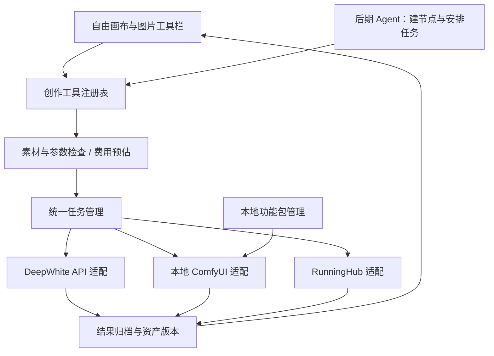

# DeepWhite Studio · 资产制作工作台设计包 v1

日期：2026-09-20。状态：待用户评审的设计，不代表新增能力已实现。仅检查本地源码、工作流文件；未提交生成、未安装模型、未验证工作流实际运行效果。

## 1. 产品定位与边界

面向知道制作步骤的专业创作者，用自由画布组织素材，以专业处理工具缩短资产制作时间。核心业务是 DeepWhite API，优先强化图片生成和资产加工；保留视频调用，后续增加剧本创作。

宣传方向：从人物效果图到正式资产，从场景参考到多角度画面，将常用制作经验变成随手可用的工具。宣传中的效率、一致性和画质提升需用真实案例验证，不承诺一键保证空间或人物一致。

确认原则：
- 自由操作，不强制完成向导或标准生产流程。
- 上传图片和生成图片使用同一套处理工具；单击显示上方工具栏，双击查看大图。
- 通过提示词实现的功能也需要独立的输入规则、可调选项和结果标准。
- Agent 剧本分析、资产提示词、自动创建不同节点和批量生成后置。Agent 复用成熟工具，不建立另一套生成逻辑。
- 基础文字、图片、视频、音频入口保留；未接通的功能不伪装为可用。MJ 独立重点设计。
- 用户不需要学习 ComfyUI；本地工作流与 RH 提供统一的创作入口。

## 2. 功能地图

| 功能域 | 本轮规划 | 关键限制/待确认 |
|---|---|---|
| 人物 | 效果图转灰底设定图；换服装、装备、手持物 | “人物多视图”即按用户原始提示词生成一张灰底三宫格，不另做正侧背选项 |
| 场景 | 角度、反向镜头、多角度、360° 环境全景 | 反向镜头不是镜像翻转；360 图需环视预览与接缝检查 |
| 编辑 | 涂抹区域、说明修改、上传替换参考 | 区分原生蒙版编辑与标注图辅助编辑，不能承诺相同精度 |
| 对比 | 两个输入的独立比较节点、滑动分界线、同步缩放 | 不同尺寸默认等比适配，像素对齐单独提供，不静默拉伸 |
| 高清 | 保真放大/允许细节重绘、倍率与尺寸 | 实际可选项由工作流暴露，不能给全部模型套同一参数 |
| 拆解重绘 | 提取线稿与色块，保留中间结果，再用作重绘条件 | 用户具体工作流尚未选定；原话未写完，重绘组合方式待确认 |
| MJ | 提示词辅助、版本相关参数、风格参考图/代码库 | 参考代码要记录版本与效果样例；原动作适配继续复用 |
| 开源能力 | 本地整合包及 RH 的高清、生图、视频 | 当前具体发行方案、支持硬件、模型授权、工作流 ID 未确定 |
| 后期 Agent | 剧本分析、资产归并、提示词、建节点、批量执行 | 创建节点与提交付费任务分离；先预览任务和费用 |

## 3. 交互与视觉

### 布局
顶部：品牌、项目名称、保存状态、任务、连接设置。左侧：少量基础节点入口。中央：自由画布。选中图片上方：人设、场景、编辑、高清、对比、更多。右侧：正在使用的处理面板，关闭即返回画布。底部：缩放、定位、整理。

视觉提案：深色中性底、低对比点阵、暖白文字、少量薄荷绿强调选中/主操作。提示和任务状态同时使用文字，不单靠颜色。暗色为第一版提案，不擅自替换正式产品主题。

节点规则：标题及资产身份在上，图片区居中；提示词输入保留可见；详细参数按需展开。复杂 MJ 表单扩大初始面板，避免关键参数挤入小窗口。画布平移/缩放不因任务刷新而变化，结果集保留在一个节点，大图查看支持左右切换。

处理面板规则：输入素材 → 方案/选项 → 输出说明 → 费用或设备状态 → 执行。提示词可展开检查和编辑。参考素材明确人物、服装、场景等角色；工具记住上次设置，但不得自动将其他人物的参考图带入。

### 三种原型路径
1. 灰底人物设定图：选人物图 → 使用用户原始提示词与默认全能图片 G2.5 高品质版 → 生成一张 4:3 三宫格图，背景 #8C8C8C。第一格为 45° 头颈特写，第二格头部留空的正面全身，第三格含头部的完整背面全身。没有视角勾选或独立视图输出选项。
2. 拆解重绘：选图片 → 提取线稿和色块 → 检查中间结果 → 调整重绘条件 → 模拟重绘。节点保留中间结果，重试不必重复已成功步骤。
3. 高清：选图片 → 选处理方案与本地/RH → 查看输入尺寸、输出目标及状态 → 模拟执行 → 双图比较。

原型所有素材是示意图，所有任务是本地交互模拟。不会联系 API、ComfyUI 或 RH，也不会展示伪造价格/模型实测效果。屏幕中的倍率和重绘强度仅为候选交互，正式参数需按工作流核定。

## 4. 程序结构

采用渐进式模块化单体：继续使用当前 Python 服务和原版画布引擎，先划分边界，暂不引入微服务、重写前端或新增第二套服务器。

### 模块职责和现有映射
| 拟定边界 | 当前依据 | 改造方式 |
|---|---|---|
| 画布交互 | static/js/canvas.js、studio-stage-one.js、studio-media-tools.js | 保留引擎，新增统一工具面板；逐步减少功能脚本相互覆盖 |
| 工具注册表 | 目前分散在媒体工具、模型能力等模块 | 集中工具 ID、输入类型、参数、输出、可用执行方式 |
| 模型能力/目录 | studio_capabilities.py、studio_catalog.py | 复用模型自动分类和两级选择；增加按工具能力过滤 |
| API 与费用 | studio_settings.py、studio_pricing.py、studio_generation.py | 保留设置、估价、任务防重复提交机制 |
| MJ | studio_midjourney.py、studio_mj_history.py | 保留专用协议与动作；增加版本化风格库和提示词方案 |
| ComfyUI / RH | main.py 原有上传、任务、查询、工作流接口 | 先包适配层，验证后再迁移代码；避免继续往大文件堆功能 |
| 资产版本 | 原版画布保存、素材库、生成记录 | 增加稳定资产 ID、结果来源、处理参数快照 |

### 统一工具契约（设计）
每个工具包含：tool_id、version、display_name、input_roles、parameter_schema、output_roles、prompt_template_version、supported_backends、required_capabilities、validation_rules。

每个工作流方案包含：recipe_id/version、tool_id、backend、workflow_digest 或远端 ID/版本、输入参数映射、输出节点映射、依赖清单、受支持参数、取消能力、价格来源及有效期。提示词工具也作为方案注册。

UI 只能提交允许的参数；工作流里的节点 ID 只留在方案映射里。用户自定义工作流属于后期高级入口，不能作为基础功能的使用前提。

### 数据对象（新增字段按需迁移，不重建旧项目）
- Project：项目名称、默认风格、画布关联。
- Asset：稳定 ID、图片/视频/文字类型、本地文件或媒体地址、尺寸、来源与角色分类。
- AssetVersion：parent_asset_ids、生成任务 ID、工具/提示词/工作流版本、用户确认标记；删除画布节点不等于删除素材文件。
- CanvasNode：节点 ID、位置尺寸、关联资产 ID、可编辑草稿；布局变化不应改变资产身份。
- Job：请求唯一键、工具/方案版本、参数及参考快照、上游任务 ID、状态、进度、结果、估价及实际费用来源。
- StyleReference：MJ 参考图/代码、适用版本、用途、样例、备注；初期只存用户确认的资料。

### 任务生命周期
草稿 → 校验 → 排队 → 提交 → 运行 → 成功 / 失败 / 取消；另有“提交结果未知”和“恢复查询中”。

- 将任务写入本地记录后再提交。刷新或休眠恢复只查询，不重新付费提交。
- 提交超时且上游是否接受不明时，保持“未知”，不自动重试。
- 只有上游支持安全取消时才承诺取消；停止查询不等于任务停止或不计费。
- 拆解重绘保存子步骤与中间资产，可从失败步骤继续。
- 本地初期单设备串行排队；显存与性能测量后再考虑并行。RH/API 限流各自管理。
- 本地与云端不自动互相切换；云端会涉及素材上传和费用，用户选择后才执行。
- 估价未知显示“费用待查询”；本地显示设备运行与耗时估计，不虚构 0 元云账单。

## 5. 工作流盘点（只读文件检查）

共发现 7 个工作流 JSON，另有 2 个配置 JSON。下列均为“有文件、待运行验证”，不是当前已交付功能。

| 文件 | 源码中的证据 | 可研究用途 | 待检查 |
|---|---|---|---|
| upscale.json | SeedVR2LoadDiTModel / SeedVR2LoadVAEModel / SeedVR2VideoUpscaler | 高清候选 | 实际输入输出、模型、显存、取消、质量 |
| Z-Image.json | z_image_turbo_bf16、采样及 VAE 节点 | 开源生图候选 | 自定义节点、模型命名、实际输出 |
| Z-Image-Enhance.json | 预处理、Controlnet、混合/锐化、两段采样 | 增强/重绘候选 | 不可据名称认定具备线稿与色块分离 |
| Flux2-Klein.json | 多图 LoadImage、ReferenceLatent、Flux2 采样 | 参考图编辑候选 | 多图映射、依赖、授权与显存 |
| 2511.json | Qwen Image Edit 编码、参考与采样 | 图片编辑候选 | 参数、参考数、模型依赖 |
| LTXDirectorv2-API.json | LTXDirector、音视频潜空间、SaveVideo | 开源视频候选 | 配套配置、时间线映射、大模型运行成本 |
| MiniMax_H3.json | MiniMaxH3ReferenceToVideo、音视频解码 | 开源视频候选 | 配套配置、设备需求、模型获取及许可 |

RH：源码已有上传、应用/工作流提交、查询和配置读取入口。本轮不读取密钥或私人远端配置，也未查询真实账号；具体工作流 ID、版本、计费和可用性待选定。

缺口：尚未确认专用的线稿/色块拆解工作流、360 全景工作流、用户最终选定的高清/生图/视频方案。需要用户提供候选文件、名称或 RH 链接后逐项验证。此缺口不影响先评审通用交互。

### 每个工作流的准入清单
输入/输出样例；精确版本与来源；依赖和模型文件校验；分发授权；参数映射；目标设备实测；正常/异常/取消/断线恢复；结果持久保存；质量样例。通过后才上架到可用工具列表。

## 6. 本地交付方案

第一阶段继续使用当前本地服务＋浏览器。桌面壳的选型在启动、升级和打包需求确认后决定，不因视觉原型直接切换技术栈。

已确认采用基础应用＋用户可选下载的 ComfyUI 整合包。整合包、环境、模型和已调试工作流由产品所有者准备；DeepWhite 负责选择目录、检查、后台启动、调用及结果接回。初期不自行拆分高清/生图/视频环境，也不另做通用环境安装器。已有环境的用户可直接选择目录，无需重复下载。

附加包下载需要磁盘/设备预检、下载进度、文件校验和版本识别；由包自身提供运行依赖。环境更新按已验证整包版本提供，不自动更新用户的自定义节点或替换模型。尚未实测前不写最低显存或“所有电脑可用”。

服务凭据保留在后端配置，前端方案和工作流包不携带密钥。资源删除与卸载分别处理，保留用户项目和生成素材。

## 7. 实施批次与验收

1. 评审本设计与原型：确认入口、面板、结果摆放、主题和默认选项。设计稿不等于功能验收。
2. 建立工具注册和统一任务适配；先迁移现有人设图，证明旧项目、旧任务仍可打开。
3. 做一条真实 API 人设路径和一条已选定的高清工作流路径，验证两种执行方式共用界面和资产归档；未获授权前只做模拟测试。
4. 扩展换装/局部编辑/对比、场景角度；完善 MJ 提示词和风格库。360 与拆解重绘需先用样例验真。
5. 接入经验证的 RH 方案与本地功能包，完成安装/升级/设备异常体验。
6. 以后加入 Agent 剧本拆解与建节点，复用工具与任务接口。

质量验收要分层：交互无跳动/可撤销；接口与参数正确；断线不重复提交；实际效果满足用途。人物身份/服装、场景空间/反向视角、全景接缝、局部修改范围、高清细节变化均需人工样例评审。

本轮待用户决定：视觉偏好与面板位置；线稿/色块重绘的具体流程；选用的本地和 RH 工作流。其余可先按本稿默认设计推进。

## 8. 评审入口与依据

- 可点击原型：`../../static/design-review/index.html`；运行中的项目可访问 `/static/design-review/index.html`。
- 原型支持三项工具切换、方案选择、模拟结果、固定灰底设定图、拆解中间结果、双图对比、清空模拟。
- 原型无需网络，不请求真实服务，示意图不能用于判断模型生成质量。
- 当前实现参考：studio_server.py、studio_generation.py、studio_capabilities.py、studio_pricing.py、studio_midjourney.py、main.py、static/studio-media-tools.js。
- 原版智能画布采用卡片及自动结果节点，不等于 Agent 自动规划完整节点图；聊天 Agent 为独立意图路由。
- 旧《DeepWhite-Studio需求大纲》保留为历史实现盘点；本稿更新产品定位和后续设计优先级，不将旧计划中的工具视为全部取消。

## 9. 本次原型检查记录

Edge 浏览器检查通过：视图选择校验、工具切换、本地/RH 切换、拆解后重绘、中间素材查看、草稿保留、倍率尺寸显示、对比分界线、Escape 关闭、重置、390px 宽布局。检查未发生外部网络请求，无页面脚本错误。

桌面截图：`../../test-output/design-v1-desktop.png`。移动布局截图：`../../test-output/design-v1-mobile.png`。交互检查记录：`../../test-output/design-v1-checks.json`。移动布局只代表原型适配，不代表正式画布触屏功能已实现。

当前正式服务 3848 未连接成功；另启动仅提供原型静态文件的临时预览：`http://127.0.0.1:3850/`。未启动或更改正式项目服务。

## 10. 用户纠正（2026-09-20）

人物多视图就是使用 `static/prompts/standard-character.txt` 的完整原文生成灰底设定图。原型已取消擅自添加的正侧背选项及独立图片输出方式，改为原提示词查看和固定规格。第 9 节的视图选择校验属于旧版历史记录，本次改版单独检查固定规格及原文一致性。ComfyUI 打包项目的调研见同目录《ComfyUI封装项目调研.md》。

## 11. 本地整合包交付已确认

用户补充：以下 D 盘目录是非纯净的个人工作环境，只作为开发参考，不能直接当作用户下载包。正式纯净整合包由用户后期另行制作；当前不清理、不打包、不分发该工作目录。

开发参考目录：`D:\deep\2026wangyi-ComfyUI-V11`。只读检查确认根目录包含 ComfyUI `main.py`、models、custom_nodes、工作流目录，以及 `python/python.exe` 和 `venv/Scripts/python.exe` 两套解释器。启动参数支持关闭浏览器自动打开、指定本机监听地址和端口。尚未判断启动器实际采用哪套解释器、附带参数及环境变量，未启动模型或修改该目录。

用户体验：选择“仅使用云端”或“添加本地运行包”；本地可下载用户发布的整合包，或选择已有目录。首次使用本地工具时由 DeepWhite 检查和后台启动 ComfyUI，不展示节点界面。工具面板只暴露产品规定的参数，任务完成后将结果接回画布。

集成责任：DeepWhite 管理运行包路径和版本、进程状态、工作流输入输出映射、素材上传、进度和错误、结果归档。用户手动启动的实例可连接复用，但不得被 DeepWhite 退出操作误关闭。DeepWhite 自己启动的实例退出时需按运行任务状态处理，不无提示中断生成。

下载整合包不是当前自动执行事项；仍先选一个已验证高清工作流及其参数映射做接入验证。MagicPot/WorkflowUI 为参考资料，不再作为环境封装的必需依赖。

Fisher 实现已按公开源码核对，见同目录《Fisher本地工作流接入分析.md》。参考其本地服务管理及工作流参数映射；DeepWhite 的用户界面仍直接提供专业工具，工作流导入与字段配置由制作方提前完成。
