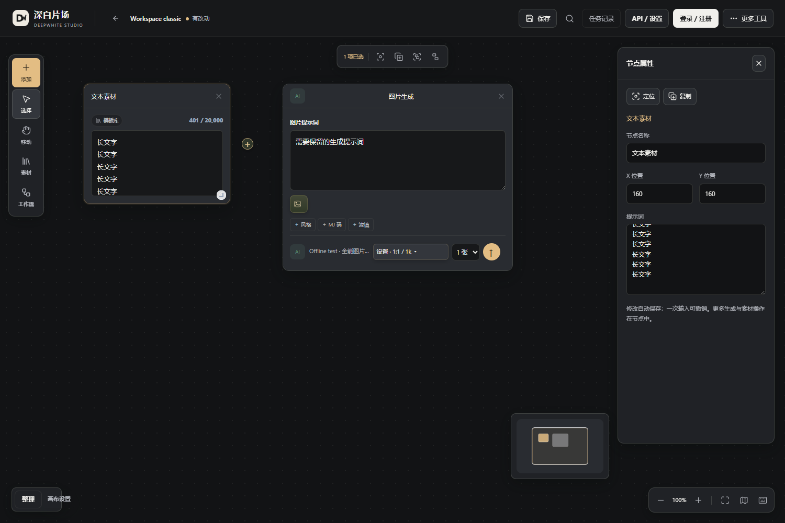
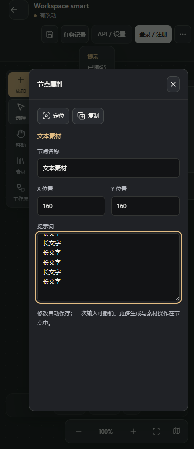
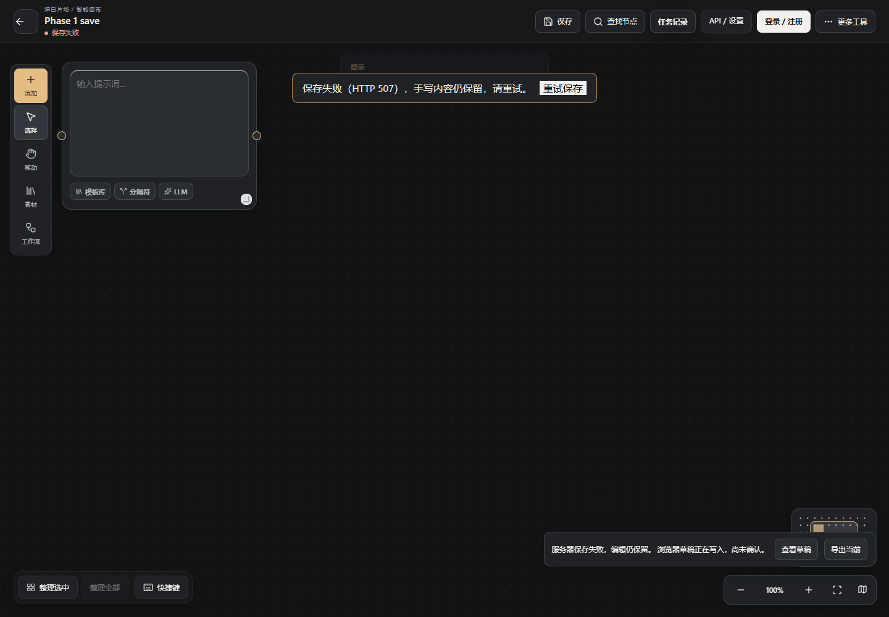

# 2026-10-19 开发交付与验证

目标账号：**344996**。画布 `deepwhite-studio-collab`，画廊 `deepwhite-gallery`。本轮在独立 worktree 分工开发、分步提交；没有修改 aslancootl 原仓库，也未把本机账号和用户项目放进 Git。

| 部分 | 本次交付 |
| --- | --- |
| 安全与保存 | MCP 编辑/收据统一原子提交、丢响应幂等重试/撤销，统一请求校验敏感字段清理 |
| 布局与核心操作 | 两画布工具位置、保存状态、原生属性面板、撤销、连线、移动、窄屏与减少动效；智能小地图保留图层 |
| 登录与自选 API | 保留免登录创作和网站账户入口，能力表、地址绑定诊断、区分模型列表与真实生成兼容 |
| 公共画廊 | 0.3.0；审核事件、媒体预览、停写备份、新目录恢复；分享/审核/带回画布闭环继续可用 |
| Codex/MCP | 13工具真实客户端联调，协议协商、schema保留及安全编辑；不自动付费 |
| Windows 更新 | 官方嵌入式Python+锁定依赖，完整包/版本包/签名清单；下载、校验、安装、备份、回退、进程崩溃恢复 |
| 维护文档 | [统一入口](README.md)、[架构和扩展](架构与扩展契约.md)、[AI指南](AI开发指南.md)、[更新维护](Windows发行与更新.md)及画廊维护/恢复手册 |

## 验证记录

可机器读取的本轮最终结果放在 [verification-20261019.json](verification-20261019.json)；分项报告位于测试输出目录，源码不上传测试运行数据与日志。

检查包括画布后端全量回归、两引擎真实浏览器交互、保存恢复、MCP客户端与浏览器闭环、供应商能力/错误提示、画廊权限/媒体/审核、提示词跨服务导入、可执行备份恢复、Windows启动和签名更新故障演练。

| 验证 | 结果 | 边界 |
| --- | --- | --- |
| 画布后端全量 | 370/370，无失败、错误或跳过 | 独立运行数据；包含安全、保存与更新单元/集成检查 |
| 画布交互与前后端联动 | 105/105 | 17核心交互+37工作区+23属性/连线+8保存+5供应商能力+9更新UI+6MCP；更新UI使用mock |
| 安装的真实Codex客户端 | 通过，发现13工具 | 实际协商、创建、编辑、相同操作重试和撤销；未调用模型推理、未改用户配置 |
| 更新core/engine/API/真实进程专项 | 42/42 | 属于后端370项的子集，不重复计总数 |
| 画廊后端和演示入口 | 56+3全部通过 | 合成账号；锁定依赖新环境再次验证 |
| 画廊浏览器流程 | 17/17 | 发布、审核、权限、预览、真实MP4播放和Range、窄屏 |
| 提示词带回画布及入口 | 8+1全部通过 | 浏览器明确确认导入，无自动付费生成 |
| 画廊CLI备份/验证/恢复 | 7/7 | 8个作品、14个文件、20条审计记录；源数据保留，向新目录恢复 |
| Windows实际包升级演练 | 8/8 | 官方嵌入式Python，特殊路径、重复启动、签名升级、成功后回退、失败自动恢复、父进程硬退出及坏新版监督程序交叉恢复 |
| 正式Windows成品 | 5/5 | 精确Git字节、包内生产验签、无全局Python启动、单实例、文字画布保存重开 |
| GitHub公开HTTPS发布验证 | 6/6 | 生产清单验签、两个ZIP完整下载和摘要、安全解压、包内更新器报告latest；无mock和登录凭据 |
| 发行构建边界与独立发布探针 | 13+6全部通过 | 私钥和运行数据排除、路径校验、真实Windows日志句柄和数据恢复 |
| 锁定依赖审查 | 画布27包、画廊18包，0个已知漏洞报告 | pip-audit 2.10.1，本次查询结果，不等于未知漏洞不存在 |

Windows演练使用独立临时Git仓库、临时签名密钥和合成`.15/.16/.17`版本。网络清单获取使用mock，实际ZIP、安装API、子服务、磁盘备份和回退均真实执行。正式发行包的来源提交、摘要和GitHub HTTPS读取验证另记在[发行产物记录](发行产物-20261019.md)；不能将本表的mock清单验证等同公网下载验证。

独立审查额外发现并修复：启动器崩溃后子服务仍可能存活的数据恢复窗口；未知事务阶段不能按旧快照恢复；格式损坏任务不能遗留维护锁。真实进程测试覆盖登记前父死、身份不匹配、父死后退出与数据锁释放。Windows SQLite检查必须显式关闭连接，回归已覆盖错误数据库后的句柄释放。

另一轮发布审查修复了启动器日志占用`userdata`导致Windows恢复不能移动目录的问题；日志现在位于`updates`。稳定启动器可在未提交事务中选用旧版运行时和监督程序，即使新Python或监督脚本损坏也能进入受锁保护的恢复。构建拒绝已提交私钥、运行数据库和异常路径；已报告的阻断问题均完成独立复测。

性能使用同一机器和同类操作对比小地图热点，100/500节点逐节点几何投影校验。并行任务会影响绝对耗时；不能把小地图模块耗时等同整体FPS或所有设备性能保证。

## 仍需配置或后续开发

- 画廊的域名、生产服务器、真实API站账号与审核员ID没有提供；网站框架和本机闭环完成，公网部署和真实账号验收尚未做。
- 未调用付费模型、未安装GPU模型/引擎；自选API按已有适配协议支持，不能承诺任意模型通用。
- 画廊站内直接生成、多媒体合集和运营功能为后续范围；现有提示词复用可带回画布或打开API网站。
- 微信按用户要求暂缓。
- MCP任意节点/智能画布通用控制、跨schema数据迁移、Windows Authenticode签名及低配长期运行仍保留在累计缺口。

旧版本说明中的“更新未实现”等文字保留历史语境，当前状态以本轮和0.10.2-studio.16累计说明为准。

## 当前界面截图

截图来自隔离测试中的合成画布，不包含用户账号或私人项目。

