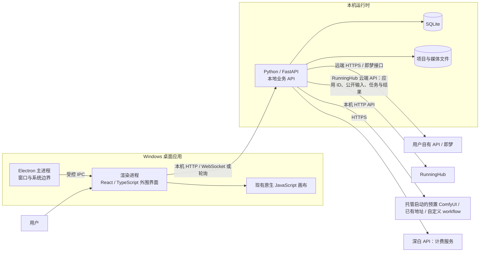

# 深白片场技术架构

> 文档版本：0.15.0
>
> 日期：2026-10-16
>
> 状态：已确认技术方向的设计基线，具体实现细节待验证

历史运行基线为 0927 版本：画布、内容库、音频、账号和工作流的实现与真实验收缺口见 [0927 全量验收表](0927全量验收表.md)。2026-10-02 的 0929 调整已从独立原型进入正式画布接入；最新状态见 [0929 验收表](0929需求与原型验收.md)，历史测试不作为本次正式功能验收。

## 官网与本地分发边界

2026-10-15 用户确认官网负责产品介绍和 Windows 本地版下载，不建设网页在线画布。官网托管与下载存储按各自流量评估，本地生成不自动转移到官网服务器。浏览器加本机服务可作为交付形式，是否增加桌面外壳待评估，不预设重写；详见[合作交接需求](画布项目合作交接需求.md)。下文为既有架构方向，本次未作源码修改或真实服务验证。

## 1. 目标与范围

深白片场定位为 Windows 独立桌面应用，提供免费、本地优先的创作画布。用户免登录即可使用本地能力，也可以配置并调用自己的模型接口；调用深白 API 的能力按服务规则收费。产品保留自有 API、即梦以及已经适配的 ComfyUI 渠道。

首个完整工作流聚焦“剧本 → 角色与场景资产”。已有视频生成、MJ 与素材处理能力继续盘点和回归；完整分镜视频制作体系与独立工具工作台留待后续，不因本次聚焦资产流程而默认删除既有能力。

本文件描述目标架构与演进约束，不代表相关组件已经全部实现。对现状、建议和待验证决策分别标注，避免将规划误认为已交付能力。

本版已结合已完成的 `需求/0927.docx` 和用户确认更新产品约束。本文涉及的新桌面流程、节点和集成均为规划，不能据此判断已经实现。

## 2. 架构决策摘要

| 领域 | 建议或现状 | 状态 |
| --- | --- | --- |
| 桌面外壳 | Electron，负责窗口、应用生命周期、安装更新及受控的系统能力 | 建议 |
| 后台服务 | 沿用现有 Python / FastAPI，作为本地业务 API | 建议；需与打包方式验证 |
| 本地数据 | SQLite 保存结构化业务数据，媒体文件单独落盘 | 建议 |
| 界面技术 | 外围界面逐步使用 React、TypeScript、Vite | 建议；渐进引入 |
| 画布 | 继续保留现有原生 JavaScript 画布；是否迁移 React Flow 由性能、功能等价和迁移验证决定 | 保留现状并待评估 |
| 旧数据 | 通过版本化迁移、备份和恢复流程接入新版 | 必须设计和验证 |
| 渠道凭据 | 用户自己的 API 凭据仅保存在本机受保护配置中，不进入项目导出或云端同步 | 建议 |
| 新建节点默认 | 先选渠道，再选该渠道可用模型，之后展示参数；记住用户最近使用的默认选择 | 已确认的交互规则，待实现 |
| RunningHub | 已有通用应用/工作流/模型接口和部分任务记录；本轮统一连接、导入、映射与队列体验 | 已有局部实现；完整范围及真实缺口见 SHUO 矩阵 |
| ComfyUI | 现有 Qwen 2.1、引擎托管、已有地址与自定义 workflow 版本/绑定基础；不自动安装模型或改变用户环境 | 已有局部实现；内部运行及完整交互需继续验证 |
| 音频 | 配音、音乐、音效列入节点与渠道设计，按批次接入 | 本轮接入，真实服务待验收 |
| 长任务 | 后端持久化任务状态，前端查询/订阅进度；不确定是否受理时不自动重提计费请求 | 必须实现 |

## 3. 现状与参考依据

以下是本架构讨论采用的已核实背景，不等同于当前桌面安装包已具备这些功能：

- “本地大雄底座”（2026-08-04）采用 HTML、CSS、原生 JavaScript 自有画布，以及 Python FastAPI 和 JSON 数据。
- 现有 Studio 位于 `本机本地路径`，版本为 `0.9.0-feedback.1`，沿用同一底座，并使用 SQLite 管理资产。
- T8 项目使用 React、TypeScript、Vite、React Flow、Zustand、Node/Express、SQLite 与 Electron。其 package.json 可作为该项目技术组合的依据，不能据此认定本项目应采用相同实现。
- AIFISHER 使用 React、TypeScript、Vite、Tailwind、Node/Express、SQLite 与 Electron。其桌面启动脚本证明 Electron 集成路线，不能据此断言其画布采用 React Flow。
- 当前实际启动路径为浏览器，而非 Electron；更新检查当前总是返回“无更新”。因此 Electron 外壳、打包更新能力都属于目标方案或待实现能力。
- 本工作区现已包含 `app/` 运行副本，程序版本 `0.10.0-0927.1`；经典画布配色及图片提示词、引用和最终预览已更新。仍以浏览器加 Python 服务运行，Electron 未实现，0927 扩展以验收表为准。
- 旧 Studio 已有提示词/LLM 输出连接生成节点、图片/提示词分组、连线目标吸附提示、按连接整理布局、双图对比、视频截帧，以及视频工作流引用音频等能力。音频生成入口明确显示“待接入”。旧 Studio 的可复用逻辑不等于新桌面端已实现。
- 旧 Studio 中模型选择器当前按模型系列/版本后选调用通道；新桌面交互已确认改为先选渠道、再选该渠道模型、最后配置参数。这是新界面规则，不应误写为旧 Studio 现状。
- 旧 Studio 的双图比较存在 `studioCompare` / `compareWidget` 节点渲染与保存兼容；当前新增入口会打开比较面板。新方案保留专用工具入口创建比较节点的要求，不把它放进通用“新增节点”菜单。
- 旧 Studio 的 `canvasArrangeAtomicIds`、`arrangeIdsByConnections` 与 `arrangeSelectedCanvasNodes` 已支持按连接整理节点；这与新需求中的网格吸附/排列是不同能力，网格交互仍需设计和实现。
- 用户已授权直接复制 Fisher 风格、MJ 码图和滤镜作者的相关内容。复用时记录来源与版本，并适配本产品的参数和接口；无需在后续实现中重复询问许可。

公开参考依据：[T8 依赖与打包配置](https://github.com/T8mars/T8-penguin-canvas/blob/main/package.json)、[AIFISHER 依赖配置](https://github.com/Work-Fisher/AIFISHER/blob/main/package.json)、[AIFISHER 桌面启动脚本](https://github.com/Work-Fisher/AIFISHER/blob/main/scripts/desktop/startSource.mjs)。这些链接为可变分支，实际复用前记录选用的提交编号；本次没有导入其代码。

## 4. 逻辑架构

### 4.1 Electron 主进程

主进程管理应用窗口、启动和关闭、本地后台进程、文件选择、深链和升级流程。渲染进程不能直接获得任意 Node.js 能力；只通过范围明确的 preload / IPC 接口调用桌面能力。IPC 参数需校验，外部链接在系统浏览器打开。

打包时应将 FastAPI 服务作为受管的本机子进程启动，并进行健康检查与关闭回收。服务未就绪时界面应展示可理解的恢复提示。服务进程的启动方式、Python 运行时打包体积和升级兼容性需在 Windows 原型中验证后定案。

### 4.2 渲染进程与画布

外围界面可以逐步采用 React、TypeScript 和 Vite，承担工作区导航、资产管理、设置、任务队列和导入导出等 UI。现有原生 JavaScript 画布继续作为独立区域运行，通过明确的消息契约与外围界面交换项目、节点、连线、选择状态和操作命令。

提示词与文本生成节点的上游输出要在当前生成节点内可见为引用内容，并允许用户继续填写本节点补充内容；提交时按清楚、稳定的规则组合，而不是只保留隐式连线或覆盖用户补充。图片和视频生成的参考素材也应显示来源、顺序与渠道能力限制。

迁移画布前，至少比较当前画布与候选实现的核心交互、真实项目负载下的帧率和内存、缩放与拖拽体验、撤销重做、键盘操作、扩展点，以及从旧画布数据往返转换的正确性。只有关键功能等价、性能可接受且数据迁移通过后，才决定是否切换 React Flow 或其他画布方案。避免以框架统一为由全面重写。

分组、节点排列和连线吸附分别建模：群组保存成员及边界，拖入/拖出时更新成员关系；连线吸附只负责连接目标预览与连接校验；按连接整理已有流程继续作为布局能力保留。新增网格吸附/排列使用明确的网格间距和用户可控开关，不得把连线吸附或现有按连接整理误当成网格布局已经完成。

### 4.3 本地服务与领域模块

FastAPI 是本机业务逻辑和数据写入的唯一权威入口。建议按领域组织模块：项目与工作流、剧本解析、角色与场景资产、生成任务与渠道适配器、媒体库、导入导出、版本与诊断。界面不直接访问 SQLite，也不自行实现另一套业务规则。

即梦、用户自有 API、已适配 ComfyUI 与深白 API 通过统一的渠道适配层接入。公共层负责能力声明、参数校验、提交、状态查询、错误归一和产物登记；各适配器负责渠道特有的认证、请求字段和状态语义。不要假设不同渠道都有相同的任务查询、取消或重试能力；能力差异应显式呈现。

RunningHub 通过 RunningHub 云端 API 使用其托管应用/工作流：应用 ID 与经应用公开的输入字段构成调用配置；提交任务后读取真实任务状态并获取结果。它是远端云端调用，与本机运行的 ComfyUI 服务分开配置、计量和报告状态。

ComfyUI 需要支持三种接入形态：应用预置并维护扩展整合包，由应用负责安装/托管启动；填写地址连接用户已有的 ComfyUI 服务；导入用户自定义 workflow 并勾选要映射为节点参数的输入字段。托管整合包应维护其 ComfyUI 版本、扩展/自定义节点清单、版本与获取来源，以及所需模型和运行依赖说明；启动前检查或提供依赖安装/修复流程。连接可用性检测只证明 API 当前可达，不能证明 workflow 所需节点、自定义插件、模型权重或其他依赖齐备；任务运行后应使用真实 queue、WebSocket 事件或查询结果报告状态，不得伪造进度；提交失败要返回真实错误并指出缺失依赖。

新增生成节点统一遵循“选择渠道 → 选择该渠道模型 → 设置参数”的次序，并记住最近一次的渠道和模型作为新节点默认值。保存的节点仍保留自己的渠道、模型和参数快照；修改全局默认值不回写既有节点。跨渠道切换时仅在目标模型能力兼容的范围内迁移参数，不静默替换渠道或收费模型。

本地模型服务不绑定桌面安装包；若以后支持，作为用户自行运行的可选服务通过明确配置接入。

节点类型按交付批次纳入剧本、角色/场景图片、视频和音频工作流。配音、音乐、音效都是音频产品范围，分别梳理输入、输出、时长、格式、同步和渠道能力后分批接入，不以“可在视频节点引用音频”代替音频生成节点。双图对比从专用工具入口创建为特殊画布节点，支持来源图片、比较设置、保存和重新打开；通用新增节点菜单不列入双图对比。

用户授权复用的 Fisher 风格、MJ 码图和滤镜内容，纳入可追溯复用清单，记录原作者/来源、复制版本或提交编号、采用范围，以及为本产品调整的参数映射。将作者内容与本产品自研代码分开管理，便于后续升级对照。

## 5. 数据与文件布局

将程序文件、用户数据、项目文件和缓存分开，避免升级覆盖用户内容。Windows 的具体路径通过系统标准目录解析，不写死用户目录：

| 内容 | 建议位置 | 说明 |
| --- | --- | --- |
| 应用程序 | 安装目录 | 只放可重建的程序文件和运行时 |
| 全局配置 | `%AppData%` 下应用专属目录 | 渠道设置、窗口状态、数据库版本等 |
| 用户项目 | 用户选择位置；默认可放 `%UserProfile%\Documents` 下的应用目录 | 项目元数据、画布、工作流和关联资源 |
| 大型媒体 | 项目资源目录或用户指定媒体目录 | 图片、音频、视频等二进制内容 |
| 临时任务文件 | `%LocalAppData%` 下应用缓存目录 | 可清理的中间文件和下载缓存 |

SQLite 存项目、资产、节点关系、任务记录和媒体索引等结构化信息；大型二进制文件以文件存储为主，数据库仅记录相对路径、类型、校验值、来源和关联关系。导出项目时封装所需媒体和结构化数据，凭据、全局配置、缓存和绝对路径不导出。

数据库需维护 schema 版本和顺序迁移。执行迁移前创建可验证的备份；迁移失败时恢复旧数据并提供诊断信息。跨盘路径应按项目相对路径解析，缺失文件可重新定位，不应静默改写成失效的绝对路径。

## 6. 本地服务安全与凭据

- FastAPI 默认仅绑定回环地址，不监听局域网地址。
- 桌面启动服务时生成短期随机访问令牌，通过受控 IPC 交给本应用；不把固定令牌写入源码、日志或项目文件。非桌面开发模式也需使用本机受限令牌或等效校验，不能因“仅本地”而开放无鉴权写接口。
- 校验 `Origin` / `Host`、请求体大小和来源，限制可访问的本地文件路径，避免渲染页面或恶意站点借本地服务执行跨站请求或读取文件。
- Electron 使用隔离的渲染上下文、关闭不必要的 Node 注入能力，限制导航与新窗口，并对外部 URL 做协议白名单校验。
- 用户自己的 API 密钥保存在本机凭据存储或加密配置中；日志需遮盖令牌、密钥和敏感请求头。密钥不得进入项目包、诊断包、崩溃报告或常规日志。
- 深白 API 的认证和计费由深白服务按正式接口协议处理。客户端只展示服务端返回的计价、受理状态和账单标识，不自行推算或伪造扣费结果。

## 7. 生成任务、收费与进度

图像或其他生成请求可能运行较久，提交接口应尽快返回稳定的本地任务 ID；持久化渠道、项目、输入摘要、远端任务引用、状态、时间戳和可展示错误。进度只能来自渠道真实返回的队列位置、任务状态、WebSocket 事件或明确的阶段回执；如果上游只提供受理状态，就展示受理/运行中等真实状态，不合成百分比或假进度。前端通过 WebSocket 推送或带退避的轮询读取进度；重连后以任务查询接口恢复状态，关闭应用不应丢失已提交任务记录。

状态建议至少包含：`queued`、`submitting`、`accepted`、`running`、`succeeded`、`failed`、`cancelled`、`unknown`。只有渠道明确支持且定义清楚时，才显示取消、重试或继续操作。

对深白 API 的计费调用，客户端为一次用户意图生成幂等键，并将其与本地任务记录绑定。服务端也须按协议支持幂等或提供可查询的受理/账单状态。如果连接在提交后中断，状态应显示为“正在确认”或 `unknown` 并先查询；不能因超时就自动重新提交，从而产生重复收费。服务端不支持幂等和查询时，必须让用户知情后显式决定下一步。

## 8. 前后端接口

本地 REST API 负责项目、资产、设置和任务管理；OpenAPI schema 作为接口类型生成的依据。长任务进度可使用 WebSocket；若渠道或运行环境不稳定，则退回短轮询，并保证接口查询可恢复。前后端应维护兼容的接口版本，桌面应用在启动时检查前后端版本匹配，并给出可操作错误。

画布与外围界面之间定义独立事件协议，建议包含协议版本、项目 ID、请求/事件 ID、类型和负载。来自画布的操作由后端校验并持久化；UI 临时状态可留在渲染进程。协议变更必须保持一个受控的过渡期，避免外围界面和画布升级错配。

## 9. 安装、更新与恢复

安装包只交付应用所需的桌面壳和后台运行时，不默认捆绑用户可自行运行的本地模型。更新检查应区分“已配置更新源且确认无更新”“更新源不可用”“尚未配置更新源”；不能统一伪报“无更新”。

更新前检查正在运行的生成任务和数据库版本兼容性，保留可回退的应用版本及数据备份。应用更新不得删除用户项目与媒体。启动失败时优先允许查看诊断日志、重新扫描资源目录和恢复最近备份；修复操作需说明可能影响的数据范围。

自有渠道暂时不可用时，用户仍可打开本地项目、编辑剧本和画布、管理已有资产；仅受影响的远端生成操作不可用。网络故障不能阻止本地保存。

## 10. 测试与验证策略

验证按层覆盖，不以“旧检查通过”替代新桌面路径验证：

| 层次 | 验证内容 |
| --- | --- |
| Python 单元与集成测试 | 领域规则、API 校验、SQLite 迁移、文件导入导出、凭据遮盖、任务状态与幂等边界 |
| 前端单元测试 | 事件协议、视图状态、错误展示、画布与外围界面的消息适配 |
| Electron 集成验证 | 安全默认值、IPC 权限、本地服务启动/关闭、端口与令牌边界、离线启动和安装更新 |
| Playwright 端到端 | Windows 上首次启动、创建/保存/重开项目、剧本到角色场景资产的主链路、任务中断恢复、导出导入 |
| 性能与迁移验证 | 代表性大型画布的交互性能、媒体量、旧项目转换、数据库备份和回滚 |

现有记录中的“115 项检查”只是历史模拟结果，本方案不将其视为当前实现的回归测试，也未在本文撰写时重新运行。待桌面实现落地后，应建立可重复的自动化测试和实际打包验收清单。新节点、ComfyUI workflow 导入映射、真实队列/事件进度、比较节点保存重开、网格吸附、配音/音乐/音效能力均需有各自的自动化或集成验收；在相应能力实现前，demo 或界面占位不算通过。

## 11. 分阶段落地

1. **需求讨论与边界收敛**：基于已完成需求逐条确认首链、音频批次、节点入口、渠道优先选择、参数和错误状态；将实现现状与规划清楚标记。
2. **可点击 demo**：独立静态 demo，用户后续确认沿用旧版配色，集中保留主题修改入口，继续审查结构和交互。demo 不连接任何服务、不包含密钥、不提交收费请求、不持久化正式项目数据；它只用于评审页面结构、状态和交互路径，不是 Electron 桌面交付。
3. **样式和交互确认**：用户确认 demo 的版式、节点入口和关键交互后，冻结可实现的 UI 规格；如反馈改变需求，先更新 demo 再进入正式开发。
4. **正式编程与桌面薄壳**：以确认规格实现 Electron、FastAPI、数据迁移、回环鉴权和项目/媒体持久化；检查进程生命周期、安装与退出恢复。
5. **首链与渠道可靠性**：实现渠道优先的模型选择、可配置 ComfyUI API / workflow 字段、文本引用、真实任务进度、计费确认及失败处理，并完成剧本到角色场景资产主链路。
6. **渐进迁移和分批扩展**：外围 UI 按模块采用 React / TypeScript / Vite；保留原生 JS 画布直至性能和等价验证通过。随后实现专用入口的比较节点、网格吸附与布局，以及配音、音乐、音效等音频批次。
7. **Windows 端到端验收与发布**：确认本地离线可编辑、渠道故障提示、真实任务状态、数据备份恢复、更新行为与打包安全。渠道失败不自动改用其他收费服务。

## 12. 待验证决策

- Electron 与 FastAPI 的打包和更新如何协调，后台是否内嵌运行时及安装体积目标。
- 本机服务令牌的安全传递和本机凭据存储方案，需兼顾开发模式与打包模式。
- 旧 JSON 项目和现有 Studio SQLite 资产是否属于同一数据迁移范围，导入时的冲突规则是什么。
- 深白 API 的真实幂等、账单查询和任务查询能力；在协议确认前不假定服务端已具备。
- React 外围界面与现有画布的嵌入方式、事件协议和阶段性技术栈。
- 画布在目标项目规模下的性能门槛，以及 React Flow 是否满足撤销重做、自定义节点和交互等价要求。
- 即梦、RunningHub 与 ComfyUI 的可用状态能力、取消语义、产物下载和失败重试规则；ComfyUI 服务可达性与 workflow 依赖满足情况须分别检测和呈现。
- 每一批音频（配音、音乐、音效）的格式、时长、同步、渠道能力及输出资产规则。
- 网格吸附的步长、开关、拖拽预览和与按连接整理的协调规则。
- 安装包签名、更新源与数据保留策略。

## 原型交互实现补充（0.2.1）

界面颜色统一定义于 `demo/theme.css`，布局样式引用主题变量，内嵌示意素材图的颜色不作为界面主题。图片节点的手写提示词与上游引用分别保留，纯文本预览按“引用＋空行＋手写提示词”实时组合；单边为空时只保留另一项。模拟任务记录点击时的最终提示词快照，后续编辑不改变该次提交。仅调整原型，不新增后端接口。

## 工作区副本（文档 0.4.0）

`app/` 从旧 Studio 0.9.0-feedback.1 复制，源码来源清单及 SHA-256 见 [复制记录](../app/provenance/workspace-copy.json)。原目录未改动。副本通过 [启动入口](../启动深白片场.cmd) 启动，自有数据在 `app/workspace`，运行环境、数据和日志不进 Git。配色在 `app/static/studio-workspace-theme.css` 集中维护；完整提示词交互接入经典画布，未替换原画布引擎。17 项生成适配离线检查、7 项存储检查及运行版浏览器检查已通过；没有执行付费调用。

## 0927 全量实施更新（0.5.0）

本轮按已确认全量方案实施，程序版本 `0.10.0-0927.1`，保留原浏览器画布与 Python 服务。当前验收以 [18 条验收表](0927全量验收表.md) 和 [版本说明](../app/docs/releases/0.10.0-0927.1.md) 为准；下文早期 Demo 边界只适用于独立原型。

Fisher 按固定公开提交导入 727 条内容；RH 闭源参考库因需要本人登录，用户已明确允许暂跳过，通用云端 API 接入继续。音频按深白文档接入配音、音乐和音效；账号注册在软件内完成，真实邮箱步骤留给用户。ComfyUI 保留 Qwen Image 2.1 预置，其他流程自行导入；不安装节点或下载模型。付费调用、邮箱和真实 GPU 结果不计入离线验证。

## 0929 需求实施阶段

2026-10-02 开始执行 [0929 需求与原型验收](0929需求与原型验收.md)。本阶段交付独立可点击 Demo 和 MJ 代码诊断；新界面评审通过后再接入正式画布。运行版仍为 0.10.0-0927.1，历史验证不代表本次真实生成验证。此次子 Agent 按用户要求使用 GPT-6.1 Sol、high 推理强度；不改变项目后续默认约定或全局设置。

## 0929 画布继续实施（0.8.0）

用户已同意继续画布并撤回画廊。正式程序继续接入已评审节点卡片、提示词和工具栏交互，同时修复 MJ 参数与任务恢复；程序版本 `0.10.1-0929.1`，本次结果与未完成项以 [0929 验收表](0929需求与原型验收.md) 和 [发布说明](../app/docs/releases/0.10.1-0929.1.md) 为准。上文 0927 和独立 Demo 验证保留历史语境，不能代替真实服务验收。

## 0930 交互修正评审（0.9.0）

最新反馈及用户确认见 [0930 需求与原型验收](0930需求与原型验收.md)。本阶段交付独立 Demo、代码诊断与测试，待用户评审后再接入正式程序；运行版仍为 0.10.1-0929.1。工具栏底板溢出与非 MJ 不兼容处理已确认，真实 RH 故障原因仍待验证。

## Studio V2 技术评审边界（0.10.0）

[新版原型](../demo/studio-v2/index.html) 使用独立静态 HTML、JavaScript 和 [集中主题](../demo/studio-v2/theme.css)，不变更正式画布引擎，不新增生产接口。具体设计、审查发现与限制见 [自检与设计评审](StudioV2自检与设计评审.md)。原型只访问本地已授权 Fisher 封面，不调用真实 API、不读取真实配置、不写入真实画布；localStorage 仅使用 `deepwhite-studio-v2-demo`，导出为演示 JSON 草稿。

节点位置、连接与视口由演示项目持有；手写、上游引用与风格/MJ/滤镜模块分别保存，模拟提交时生成快照。非 MJ 模型排除 MJ 代码，选择仅使用氛围描述不切换模型。参数和详情草稿绑定原项目与原节点，遮罩/Esc 关闭保留草稿，拖出弹窗不误触关闭。任务归档与恢复绑定原项目、原节点和原任务，不因切换画布改写当前节点；存储失败应提示并停止该次模拟提交。

正式补丁 `0.10.1-0929.2` 单独修复通用生成目标隔离及提示词提交边界，不表示新版 UI 已接入。目标隔离 22/22、媒体工具 4 组和旧 stage-one 10 组为本轮离线结果；新 Demo 两尺寸实点已通过，新增存储/焦点回归及最终截图待主 Agent 整合。真实服务未重启、真实供应商未调用，运行生效与真实媒体归档另行验证。React Flow、Electron 与 SQLite 的迁移决策保持原评估边界。

## 画布产品化持续优化（0.11.0）

2026-10-03 根据 LibTV 公开首页与 TapNow 官方画布帮助继续优化交互。新增框选、原位新建、拖动连线、多选分组、复制隔离、搜索定位和小地图；保留原配色、节点内编辑与独立演示数据。竞品可见事实、我们自定动效和完整产品验收边界见 [画布产品化验收](画布产品化验收.md)。

新版仍先由用户评审再接正式界面；已通过的原型行为不能代替真实渠道验收。保存与 RH 正式修复独立推进，仍以对应软件发布记录为准。整体目标保持进行中，不以一轮原型或一组测试代替完整交付。

## Studio V2 正式接入（0.12.0）

2026-10-03 用户确认“按这版方向接入正式画布”。首页与经典画布接入共享主题、工具栏、节点和空间操作；智能画布保持其原布局，任务可靠性修复覆盖两种画布。正式源码版本 [0.10.2-studio.1](../app/docs/releases/0.10.2-studio.1.md)。Demo 独立保留，真实供应商、GPU、邮箱及运行版本仍分开验收；本次未重启真实服务。

## 智能画布、草稿与性能修复（0.12.1）

延续已确认方向，将智能画布与设置统一到共享主题；补齐经典及智能画布的浏览器草稿保存、显式恢复与冲突副本。修复跨项目撤销污染，检查 100/300 节点下平移、框选、保存与切换的实际耗时。实现、实际测试统计和未完成项见 [本版说明](../app/docs/releases/0.10.2-studio.2.md)，恢复操作与同源存储限制见 [浏览器草稿恢复](浏览器草稿恢复.md)。

草稿不是数据备份，恢复不自动提交生成。本次未重启真实服务，未执行付费、真实邮箱或 GPU 验收；短时性能检查不等于低配、长会话或全部 bug 已清零。继续使用 GPT-6.1 Sol、高推理强度子 Agent 在各自文件范围实现，由主 Agent 统一审查、验证与提交。

## 撤销、编辑性能与专业工具（0.12.2）

延续用户确认的 Studio V2 方向，本版统一裁剪/预览、生成日志、内容库及经典画布助手，保留各自已有功能。两种画布的编辑历史与任务数据分别处理，避免撤销覆盖新回执或让晚到结果失去目标；删除恢复不自动继续或提交任务。具体行为见[画布撤销与任务保护](画布撤销与任务保护.md)。

根据浏览器性能采样，优化引用更新时重复全量图标重绘，以及没有有效 Skill 关系时的强制布局。测试结果、同规模耗时与未完成项以[源码说明](../app/docs/releases/0.10.2-studio.3.md)为准；历史数据不冒充本次验证。本版未重启真实服务，没有真实付费、GPU、邮箱或生产回退验收。

## 媒体交互与画布性能（0.12.3）

经典画布改为离线构建 Tailwind 工具样式，正式页面不再加载运行时编译器。导航图消费 ResizeObserver 提供的边框尺寸；模型装饰只处理受影响节点。构建输入、散列和更新步骤见[画布静态样式构建](画布静态样式构建.md)。

本次结果与全部剩余范围见[源码说明](../app/docs/releases/0.10.2-studio.4.md)。本版未重启真实服务，未执行真实付费、GPU 或邮箱验收。

## 清晰编辑与手势可靠性（0.12.4）

延续已确认方向，智能画布的选中编辑卡与操作条保持屏幕尺寸，经典画布减少拖动过程中的全图样式与几何计算，补齐缩放撤销和异步切换的目标保护。操作边界见[画布缩放与编辑](画布缩放与编辑.md)，本次实测及未完成项见[源码说明](../app/docs/releases/0.10.2-studio.5.md)。

本轮隔离验证的具体结果见上述源码说明，历史通过数不计入本次结果。未重启真实服务，付费、GPU、邮箱及完整桌面发行仍待验收。

## 导航连线与编辑生命周期（0.12.5）

继续优化已确认的画布交互：纯视口缩放与定位保持原连线，定位动画在用户操作时停止，6% 缩放按原值恢复；智能编辑框保持原位，修复保存后原生撤销历史失效。实现、实际验证与剩余范围见[源码说明](../app/docs/releases/0.10.2-studio.6.md)。本轮隔离专项和跨模块回归已通过；历史结果不作为本次验收，真实服务未重启。长期稳定与真实服务仍按版本说明保留缺口。

## 文字与视频任务可靠性（0.12.6）

继续按已确认界面方向完善创作流程，已补齐原生文字与视频的固定任务身份、保存核对、查询恢复及错误反馈；统一任务卡、结果预览和智能通知，修正输入框对比度与顶部工具条遮挡。具体隔离验证和剩余协议范围见[源码说明](../app/docs/releases/0.10.2-studio.7.md)，操作见[文字与视频任务恢复](文字与视频任务恢复.md)。真实收费、GPU、邮箱、生产运行与长期稳定性仍待分别验收。

## 经典生成节点提示词层级（0.12.7）

本轮源码 [0.10.2-studio.8](../app/docs/releases/0.10.2-studio.8.md) 调整经典图片与视频生成节点：上游只读区按实际输入顺序显示原始文字，手写输入保持独立，来源标签不重复正文；风格模块加工不伪装上游，媒体沿用素材缩略条。移除重复原生 PROMPTS 白卡，0929 已取消的常驻最终预览不恢复，焦点与只读文字层级沿用共享主题。

本轮提示词隔离浏览器专项 26 组通过，覆盖两尺寸四主题、真实滚轮、键盘/选中文本、保存重开和节点隔离；受影响兼容回归结果见本版发布说明。源码和样式冻结后的同 26 组复跑及样式等价 5 组通过，最终文档 23 项检查通过；旧通过数仅为历史。完整未完成项见[累计状态](../app/docs/releases/0.10.2-studio.8-status.md)。整体产品持续验收，不代表全部 UI 或全部需求完成；本轮未重启真实服务、未读取生产，未进行真实付费、GPU 或邮箱操作。

## 经典生成参数与紧凑操作栏（0.12.8）

本轮源码 [0.10.2-studio.9](../app/docs/releases/0.10.2-studio.9.md) 调整普通经典自有 API 图片（含 GPT/G2）与视频：沿用紧凑生成栏，把原 DOM 参数收进共享主题弹层，保留中文分辨率/比例/质量/数量、自定义尺寸与比例及参考自适应；摘要读取实际有效参数，并同步数量按钮和异步媒体尺寸，不强制改用户节点宽度。单个活动弹层响应窗口/内容变化并释放观察器。

原生参数独立撤销已实现并通过本轮隔离专项，范围限定本轮普通图片/视频参数处理器，不推断全部原生模型切换可独立撤销。真实原生生成按钮、固定请求快照、两个 mock 图片任务请求、渠道往返、保存重开、两尺寸四主题、短窗口滚动及弹层生命周期已纳入本轮 33 组隔离专项；模型归属 20、历史保护 67、提示词兼容 26 组也通过，增强 10、经典 14、旧任务 36 组通过；反序响应保护已纳入最终 33 组，样式等价 5 组与构建通过；最终文档 23 项检查通过。完整能力与未完成项见[累计状态](../app/docs/releases/0.10.2-studio.9-status.md)，旧通过数只作历史。

.8 的上游原始文字、独立手写与素材缩略条保留；0929 常驻最终预览不恢复。原生参考素材替换/断开同步参数；异步参考比例与适配尺寸在原节点/画布或参数已变化时丢弃，适配尺寸可撤销。整体产品持续验收，本轮不改后端协议、不访问生产或重启、不进行真实付费/GPU/邮箱操作，不代表全部 UI 或全部需求完成。

## SHUO 主标杆与完整产品优化（0.13.0）

2026-10-04 用户确认以 SHUO Canvas 为主要标杆，优先 RH/ComfyUI 及软件内运行体验，并已口头确认获得作者使用代码的同意。本轮完整目标与证据见[SHUO 参考与产品优化验收](SHUO参考与产品优化验收.md)：连接/导入/参数/复用节点、统一排队/取消/恢复、素材与完整项目包、Agent 剧本/资产与分镜工作区、媒体工具和整体视觉交互、真实验证及 Windows 交付均持续跟踪，不收窄为首个 Demo。

新界面先交[独立 workflow-studio Demo](../demo/workflow-studio/index.html)评审，本轮冻结后 19 组隔离浏览器检查与 JS 语法检查通过；两尺寸连接、配置、预览截图无横向溢出，主 Agent 已人工查看配置截图，仍待用户评审。范围仅为连接、导入、参数预览和可复用节点；任务中心与取消/恢复后续单独评审，模拟状态不等于正式 RH、ComfyUI 或 GPU 已接通。正式软件仍为 0.10.2-studio.9，本轮不改 app、不更新或重启生产；文档 0.13.0 不代表软件发布。当前及历史完整功能缺口继续继承[.9 累计状态](../app/docs/releases/0.10.2-studio.9-status.md)，本轮验证另记，不借用旧通过数。

保留 Windows、自有 API 与本地画布免登录、软件免费/深白 API 按服务收费、唯一 Qwen Image 2.1 预置及不自动安装模型的约束。在线画廊不恢复、RH 闭源库继续暂缓，云同步/多人协作/自动更新保持原范围；Fisher 是否参考 SHUO 无可核对证据，不作为事实。旧源码、公开说明与官方 v0.8.0 包静态证据分别记录，包和提取文本哈希已复核，但未执行安装包或取得完整可读后端，持久幂等未核实；本轮无真实付费、GPU、邮箱或生产操作。

## 工作流工作台正式接入（0.13.1）

用户已批准 RH/ComfyUI 工作流 Demo 的“来源 → 参数配置 → 节点预览”布局，正式源码 `0.10.2-studio.10` 已接入统一工作台、本地版本库、参数编辑、草稿与固定版本节点。两种画布可管理与预览；本版新建 RH/自定义 ComfyUI 节点使用经典画布，智能画布缺少原生创建能力时明确提示。保留 Qwen Image 2.1 预置。

自定义 ComfyUI 补齐精确整数、预览图验证、保存屏障、固定请求与输出目标、原请求账本核实和并发版本保护；RH 提供独立本地配置版本，提交固定工作流图，仍沿用原任务链。复制、撤销与浏览器草稿识别新增任务字段。实际验证及最终冻结结果见[本版说明](../app/docs/releases/0.10.2-studio.10.md)；完整继承[累计状态](../app/docs/releases/0.10.2-studio.10-status.md)，不引用旧通过数冒充当前结果。

原生 legacy ComfyUI 字段精度未改；RH 本地应用配置不能冻结远端内部实现。未重启真实服务、未读取生产，没有真实付费/GPU/邮箱验收。源码与运行版本分开，真实服务、完整任务中心、项目包、创作工作区和 Windows 发行继续按[完整矩阵](SHUO参考与产品优化验收.md)实施。上文旧章节的“待评审”仅描述历史阶段。
