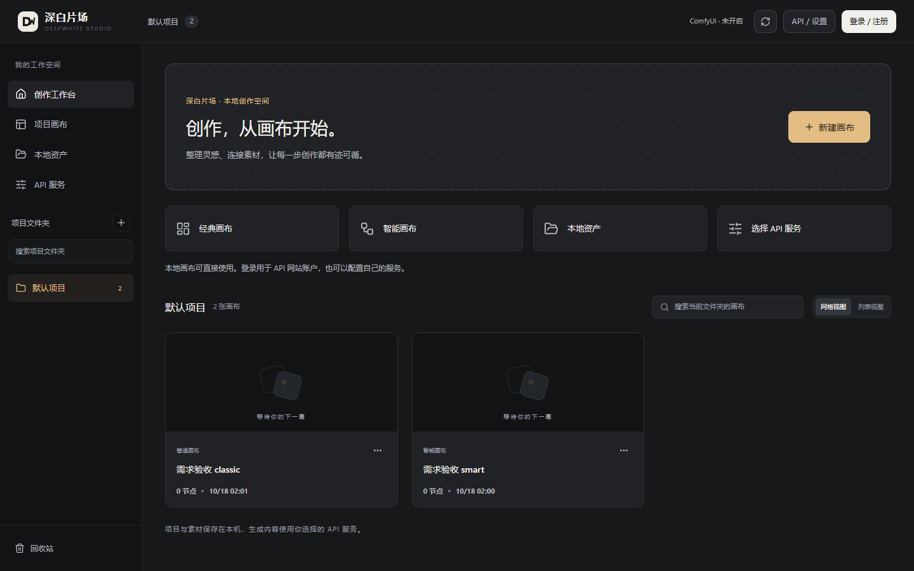
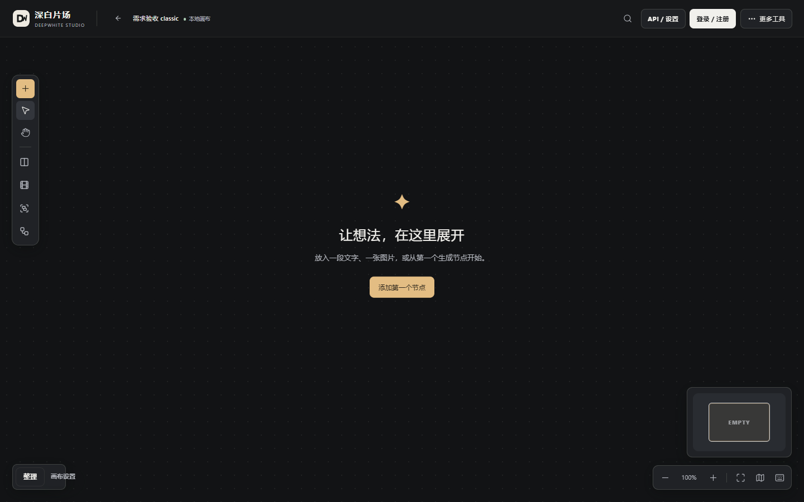
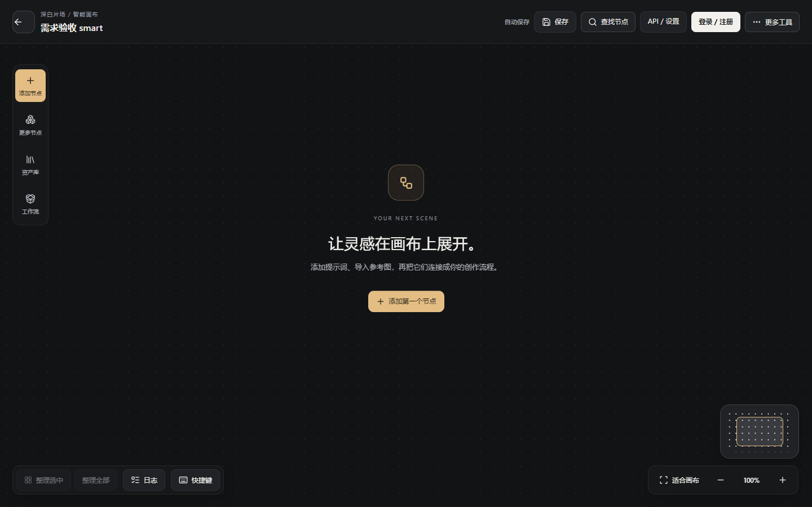

# 本轮修改与测试

日期：2026-10-18。版本：**0.10.2-studio.12**。目标仓库：**344996/deepwhite-studio-collab**。

## 已完成

1. 创建用户指定的公开仓库，保留原始提交和许可证。第一批安全、保存、恢复、数据库连接及核心画布操作修复已经提交，基线提交为 `9e84b6a`。原仓库和此前的独立修复副本没有被替换。
2. 参考 LibTV 首页的导航和新建入口组织方式，增加工作台导航、经典/智能画布快捷创建、本地资产和 API 入口；保留现有项目管理。[参考页面](https://www.liblib.tv/)
3. 两种画布把搜索、API 和账号放在常用位置，辅助工具收进“更多工具”；改善窄屏布局、键盘焦点、弹层反馈及减少动态效果支持。没有改变节点存储格式和生成引擎。
4. 智能画布接入原有登录注册模块，三页保持一致；登录窗口不再等待供应商余额查询。本地创建编辑不要求登录，生成服务继续由用户选择。
5. 补充源码基础依赖、全新 Python 环境启动验证、AI 开发指南以及微信登录、画廊、在线更新和 MCP 的方案/工期/示例预算。

## 实际测试

| 范围 | 本轮结果 | 可复测入口 |
| --- | --- | --- |
| 全量后端回归 | 279 项通过，零失败、零错误、零跳过 | `app/tests/run-phase1-backend.py` |
| 工作台/账号入口/响应式/主题 | 34 组通过 | `app/tests/check-workspace-requirements.cjs` |
| 第一批画布交互 | 17 组通过 | `app/tests/check-phase1-interactions.cjs` |
| 第一批保存与恢复 | 8 组通过，含 5 组受控时序和 3 组完整浏览器流程 | `app/tests/check-phase1-save.cjs --browser` |
| 原有画布相关回归 | 167 组通过：画布 14、指针 31、保存 13、草稿 38、历史保护 71 | 对应 `check-canvas-*.cjs` |
| 注册模拟流程 | 1 条完整流程通过，覆盖表单、验证码请求、协议勾选和返回登录 | `app/tests/check-studio-account-registration.cjs` |
| 新建 Python 环境 | 安装基础依赖、启动、health 版本及两类画布创建/读取通过 | `requirements.txt` + 隔离模拟服务 |
| 源码检查 | 修改的 JavaScript 与后端模块语法通过，提交前差异与文档链接核对 | 仅检查，不启动真实服务 |

浏览器专项覆盖 320、390、768、1024、1440 像素宽度，以及炭灰、牛奶白、浅色、深色四种主题。窄屏导航支持键盘打开、焦点进入和返回。截图在画布实际加载后采集。

结构化结果见 [本轮验证摘要](verification-2026-10-18.json)。后端使用 Python 3.12.7，新增浏览器专项使用 Chromium 151，既有回归使用本机 Edge。测试运行在独立目录并模拟或拦截上游，没有使用用户真实项目和凭据，没有实际发送注册邮件或调用付费生成。

完整本机日志位于 `app/test-output/`，该目录不上传。首次红测和调整过程也保留：新入口实现前测试失败；创建画布检查按原流程先创建列表卡片再打开；窄屏视觉复查补充了正常加载等待和顶部缩放修正。最终结果以本报告和验证摘要为准。

## 界面预览

工作台：

经典画布：

智能画布：

## 按文档继续开发的范围

已完成文档：[AI 开发指南](AI开发指南.md)、[扩展功能评估](扩展功能评估.md)、[需求映射](requirements-2026-10.md)。

微信登录、公共画廊、在线更新和通用 MCP 扩展按照原文档先提供评估，没有伪装成已经上线的功能。已有 MCP 基础继续保留，真实 Codex 客户端联调尚未执行。

本版为可按说明启动的源码交付，仍不是完整 Windows 安装包。真实 API 网站账号、全部付费渠道、GPU、物理断电、跨进程写入和长期大画布性能未验收；项目索引备份也不等于完整媒体备份。当前账号站沿用源码中的 `https://api.deepwhiteai.com`，如需换站应先提供兼容接口并单独联调。
