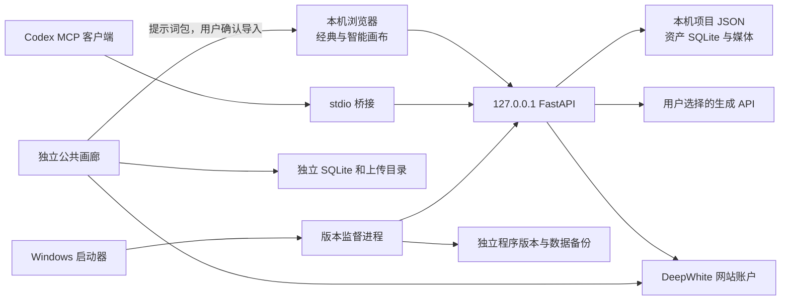

# 架构与扩展契约

适用：画布 0.11.0-studio.1、画廊 0.4.0。原生 JavaScript + FastAPI；不需要迁成 React、Electron 或 Next.js 才能继续开发。

## 服务与数据归属

画布默认只监听 loopback，Host、Origin、WebSocket 均有本机边界。公共画廊是独立网站，不能通过放开画布监听地址来代替网站部署。

源代码运行由 `DEEPWHITE_STUDIO_RUNTIME_DIR` 指定数据目录，默认 `app/workspace/`。Windows 发行包固定使用安装根目录的 `userdata/`；程序放在 `versions/<版本>/`。画廊使用自己的配置数据目录，两者没有共享数据库。

## 修改位置

| 需要修改 | 主要文件 | 扩展规则 |
| --- | --- | --- |
| 页面导航、工具位置、保存提示 | `app/static/studio-workspace.js/.css`、`studio-canvas-workspace.js/.css` | 共用原引擎状态；不复制一套 nodes/save 状态 |
| 节点内编辑与选中工具条 | `app/static/studio-node-composer.js/.css`、`studio-canvas-inspector.js` | 复用原生历史、修改和保存方法；输入控件不能传播快捷键至画布 |
| 经典/智能画布核心 | `app/static/js/canvas.js`、`smart-canvas.js` | 两种数据结构分别处理；撤销、复制与草稿不得复制旧任务身份 |
| 主题、动效 | `app/static/studio-v2-theme.css`、工作台样式 | 使用主题变量；拖拽世界坐标不加 transition；支持 reduced-motion |
| 注册新后端模块 | `app/studio_server.py` | 独立模块的 install(app/core)，不要继续堆叠 main.py |
| API 供应商与模型 | `studio_settings.py`、`studio_catalog.py`、`studio_capabilities.py`、`studio_provider_capabilities.py` | 先确定实际协议；同步列表不等于生成兼容 |
| 生成、轮询、结果归属 | `studio_generation.py`、`studio_native_tasks.py`、`studio_legacy_tasks.py` | 请求标识、凭据地址绑定、持久回执；未知提交结果不能自动再付费 |
| 网站账号 | `studio_account.py`、`studio_account_extension.py`、`studio_account_provision.py` | 账号会话与供应商 API Key 分离；不能强制登录才能本地编辑 |
| 资产 | `studio_assets.py`、`studio_storage.py` | 资产版本与项目归属；SQLite 显式关闭，原件不覆盖 |
| MCP | `studio_control.py`、`studio_graph.py`、`studio_mcp.py`、`studio_mcp_config.py` 及两个 tools.json | HTTP 与 MCP 共用验证；编辑内容和回执单文件原子提交 |
| 统一校验错误 | `request_validation.py` | 只返回允许的字段位置和安全错误描述，禁止 input/ctx/用户动态字典键泄漏 |
| 画廊带回画布 | `studio_gallery_import.py`、`static/studio-gallery-import.js` | 包有版本、预览后确认、幂等创建；不自动调用生成，不携带 API Key |
| 更新 | `studio_update_core.py`、`studio_update_engine.py`、`studio_updates.py`、`studio_portable.py` | 签名清单、用户数据隔离、受控子进程、提交点和回退规则 |

路径未写前缀的 Python 模块位于 `app/`。准确字段以 Pydantic 模型、工具 schema 和回归测试为准。

## 主要接口

| 接口 | 作用与契约 |
| --- | --- |
| `GET /api/studio/health` | 运行版本、安装路径、进程和 ready；用它核对实际运行程序 |
| `/api/projects`、`/api/canvases` | 本机项目与画布；保存前读版本，保留冲突处理和索引恢复 |
| `PUT /api/canvases/{id}` | 使用 base_updated_at；409 后重新读取并解决冲突，不盲目覆盖 |
| `GET /api/studio/settings/provider-capabilities` | 各种能力、适配状态、模型数量、最近列表检查；不含密钥 |
| `POST /api/studio/settings/test` | 只读取模型列表；连接记录绑定当前地址，不代表真实生成验收 |
| `POST /api/studio/control/call` | 受控工具入口；开启控制后仍检查 token、revision、操作 ID 与生成批准 |
| `GET /api/studio/updates/status` | source/unchecked/available/downloading/ready/installed/rolled_back 等真实阶段 |
| `POST /api/studio/updates/check` | 从固定发布源取清单，校验签名、有效期、序号与兼容性 |
| `POST /api/studio/updates/download` | 后台下载、校验、暂存；通过 status 查看进度 |
| `POST /api/studio/updates/install` | `{action:"install"或"rollback",saved_and_closed:true}`；同源、发行包、监督进程、空闲画布和任务检查 |

旧 `/api/check-update` 返回同一状态。源码版不会伪造“已是最新版”；原上游覆盖式更新仍被拒绝。

## MCP 的确切范围

当前 13 个工具由 `studio_mcp_tools.json` 和 `studio_graph_tools.json` 提供。既有工具涵盖画布/模型/资产读取、生成节点写入、审批请求、任务查询与撤销；项目列表、节点 schema、创建普通画布及文字/移动/连线编辑由 graph 模块提供。

工具名称：`list_canvases`、`get_canvas`、`list_models`、`list_assets`、`apply_nodes`、`undo_edit`、`generate_node`、`get_generation`、`resume_generation`、`list_projects`、`get_node_schema`、`create_canvas`、`edit_canvas`。

操作前先读 `get_node_schema` 和 `get_canvas`。编辑使用 `expected_revision` 与全局唯一 `operation_id`；同一操作重试保持原 ID 和原参数。服务端把编辑结果、快照和回执放在同一画布的原子写入内，不能改回“先写画布再写另一个回执文件”。不同工具不能复用相同 ID 造成新操作。编辑回执丢失时重读/重试，不重新随机创建节点。

撤销仅允许最近一次且无后续修改的受支持操作；重复撤销返回原回执。复制画布应清理控制日志和运行任务身份。不要把 task_id/provider receipt 复制到新节点后继续轮询或自动付费。

真实 Codex app-server 已通过 stdio 服务发现与工具调用验证，协商协议 `2025-06-18`，配置在隔离子目录中，未改用户现有 Codex 配置。对于只支持更新协议的客户端，不声称兼容；桥接保留已实现的版本协商和回退测试。普通画布有限编辑可用，智能画布与任意节点的通用编辑仍需新适配器。

## 画廊扩展

画廊源码独立在 `344996/deepwhite-gallery`。0.3.0 包含图片、MP4、纯提示词作品、私有草稿、提交/退回/发布/撤回/下架、审核事件、缩略图和备份恢复。用户需主动发布，默认不会扫描本地项目或上传全部资产。

“带回画布”只携带用户分享的提示词与作品来源，确认后创建普通画布，不搬运凭据。复制提示词和跳转 API 网站可用；网站内直接付费生成、单作品多媒体合集仍是后续功能。接入直接生成时应复用单独的任务表、幂等请求标识、费用确认和结果归属，不能在页面刷新或 GET 读取时提交生成。

审核日志应与作品状态在同一 SQLite 事务中写入；媒体预览必须继承原作品访问权限，撤回后不能通过缩略图 URL 继续公开。管理员按真实 API 站用户 ID 配置，不能把 GitHub 账号名当 API 用户 ID。演示管理员仅存在于独立演示数据。

## 推荐 AI 开发任务

每次任务先读当前版本状态，限定一条可验收的用户流程；后端新增模块，前端复用原事件。对保存、撤销、任务、迁移、权限变更增加真实失败回归；纯文案/颜色调整不用制造镜像实现的测试。

新增 API 模型：确认官方文档 → 能力表 → 参数验证 → 提交/轮询/下载适配 → 固定 mock 故障测试 → 用户明确配置后真实小额验收。真实调用和 mock 结果分别记录。

新增更新的数据 schema：先实现并测试可逆迁移、升级前后读取兼容和中断恢复，再放开版本限制。当前只支持 schema 1，未知数据版本明确拒绝。不要为了让更新通过而删除 schema 校验。

发布前同步 VERSION、CHANGELOG、版本索引、累计功能和验证报告；安全、保存和付费生命周期不能因“只是界面改动”跳过相应回归。

## 本版新增契约

内置助手运行路由已移除；`studio_canvas_services.py` 统一画布版本、共享锁、上下文和节点验证，`studio_models.py` 统一模型目录。MCP 和普通保存必须继续共用它们。账户自动连接、反馈收据与新界面扩展分别见 [账户/API](ACCOUNT_API_CONNECT.md)、[反馈接口](反馈收集与扩展.md)、[外接智能体](EXTERNAL_AGENTS.md)。
